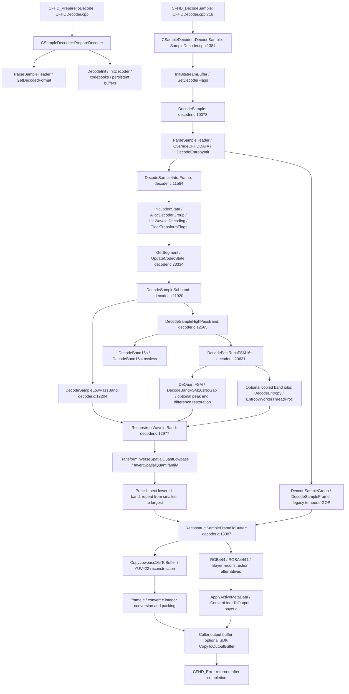

<!-- Copyright (c) 2026 HyperCine Contributors. MIT OR Apache-2.0. -->
# Decode Phase 0: architecture, CPU reference and CUDA plan

## 1. Scope, provenance and status

Work branch: `decode-phase0`, created from public `main` after fetching
`origin/main`, both at `51435890ba5853e87e8cf1ddc7cc747954bd9e80`.
The checkout was initially clean. `v0.1.0-alpha` was present and was not moved.
The upstream subtree tree object is `837528ef9e9a55c416e9592ecb54e1c8f1ff9cf8`,
identical to the tree of `upstream-baseline-11574d0`, whose commit is
`11574d0295771edccadd17af14af74a539f924c7`.

This phase adds research documentation, a standalone CPU decode benchmark,
an opt-in isolated stage profiler, a generated golden corpus test and their
CMake registration. No production encoder file or public API changes. No GPU
decoder implementation, merge, release, tag change or history rewrite.

Measurements use Windows x64, Ryzen 9 7940HS (16 logical processors), MSVC
19.44 / VS 2022 Release (`/O2`, `/MD`), CUDA 12.8 for existing regression tests.
`nvidia-smi` identifies an RTX 4090 Laptop GPU, 16,376 MiB and maximum PCIe
generation 4, width x16. These are reported capabilities, not measured DMA
bandwidth or a claim about the active link under load.

Artifacts:

* [Stock CPU baseline](../benchmarks/results/decode_phase0_windows_msvc.json)
* [Exclusive stage profile](../benchmarks/results/decode_phase0_profile_windows_msvc.json)
* [Golden hashes](../tests/decode_phase0_golden.txt)
* [Validation record](../benchmarks/results/decode_phase0_validation.json)

The JSON provenance `source_commit` is the frozen production source base above.
Phase 0 harnesses were local additions at measurement time; their SHA-256 hashes
are recorded separately in the artifacts. FNV-1a-64 is used for corpus regression
hashes; it is not a security digest. Pixel repeatability is also checked by a
complete byte comparison, not only a hash comparison.

## 2. Entry point and call graph

Preparation and decoding are distinct API contracts. `CFHD_PrepareToDecode`
selects the output format/resolution and allocates persistent state. Timed decode
is `CFHD_DecodeSample`, beginning with a complete sample in aligned host memory.



Source paths below are relative to `upstream/`, which is frozen. The graph shows
alternatives, not a claim that every function executes for every format. The
measured progressive YUV422 -> BGRA/YU64 samples use the integer planar path;
active LUT processing hooks have zero calls. YUY2 has a different final strip
worker path. `CFHD_DecodeSample` also probes the caller output buffer before
dispatching to the SDK class.

### Stage/state inventory

| Stage / granularity | Source and function | Inputs -> outputs | Mutable state and prerequisites | Thread behavior |
|---|---|---|---|---|
| Prepare / frame configuration | `DecoderSDK/CFHDDecoder.cpp:386`, `SampleDecoder.cpp:857`, `PrepareDecoder`, `GetDecodedFormat`, `ParseSampleHeader` | sample + requested geometry/format -> actual geometry/pitch + prepared decoder | `m_encoded*`, `m_decoded*`, `m_output*`, `m_decodedFrameBuffer`; valid header and format lookup required | caller, persistent setup; excluded from baseline timer |
| Header/sample dispatch / frame | `Codec/decoder.c:2140`, `ParseSampleHeader`; `DecodeSample:10078` | sample tags/index -> encoded format, dimensions, sample type and source precision | `SAMPLE_HEADER`, `decoder->frame`, `CODEC_STATE`, bitstream cursor/error; length and tag validation | caller; may select stereo/temporal alternatives |
| Metadata / frame and row | `Codec/lutpath.cpp:1250`, `OverrideCFHDDATA`; `DemoasicFrames.cpp:5636` CPU override; SDK `CFHD_SetActiveMetadata` | embedded metadata + explicit override -> `CFHDDATA`, process flags, LUT/CPU configuration | metadata chunks, override block, color/white point, database state; must precede worker creation | caller before entropy; some color processing later runs per row |
| Channel/wavelet setup / frame, channel, level | `decoder.c:1140`, `AllocDecoderGroup`; `InitWaveletDecoding:1401`, `ClearTransformFlags:1377`, `DecodeSampleIntraFrame:11584`, `UpdateCodecTransform`, `GetWaveletThreadSafe` | dimensions, transform and channel tags -> `TRANSFORM`, `IMAGE`, band storage and mapping | allocated wavelets, band widths/pitches, valid/started flags; requires parsed transform geometry | caller, allocation locks in threaded configuration |
| Tag/band orchestration / channel and band | `UpdateCodecState:23334`, `DecodeSampleChannelHeader:11865`, `DecodeSampleSubband:11920` | tags -> quantization, codebook, peak data, band method, decode invocation | `codec->channel`, `band`, `active_codebook`, `difference_coding`, peak pointer, decoded flags, cursor | caller walks syntax; threaded mode snapshots jobs before advancing cursor |
| Lowest LL coefficients / band, row | `DecodeSampleLowPassBand:12204` | fixed-bit/big-endian LL payload + offset/precision -> signed-16 LL | wavelet band 0, lowpass cursor/parameters; offset/scaling can depend on output format | caller; band independent after descriptor capture |
| Highpass VLC / band | `DecodeSampleHighPassBand:12565`, `DecodeFastRunsFSM16s:20631`, `DecodeBandFSM16sNoGap:19532`, `entropy_threading.c:DecodeEntropy` | band payload + FSM/codebook + quant/peaks -> signed-16 coefficient array | FSM state/restore LUT, cursor, output position, flags; `ResetFSM` starts each band, zeroes full band | caller when entropy pool is zero; otherwise independent band job with worker-local FSM |
| Raw/lossless alternative / band | `DecodeBand16s:12790`, `DecodeBand16sLossless:12862`, `DecodeBandFSM16sNoGap2Pass` | method-specific coefficients -> signed-16 band | band type, quantization, stream position; not exercised by this FilmScan3 corpus | caller or method-specific path; do not infer VLC invariants for these alternatives |
| Coefficient restoration / band and row | `DecodeFastRunsFSM16s`, `DecodeBandFSM16sNoGapWithPeaks`, `DeQuantFSM:20551` | run/value output + optional peaks/difference flag -> restored coefficients | peak table bounds, row accumulator; difference coding resets at each row and sums from x=1 | serial within entropy band; predictor can later be implemented by row scans |
| Inverse quantization / LUT and coefficient | `decoder.c:DeQuantFSM`, `ReQuantFSM`; `quantize.c:2692`, `DequantizeBandRow16s` | signed/companded value + quant multiplier -> reference dequantized value | `LastQuant`, `InitizedRestore`, `restoreFSM`, per-band quant; modern fast path folds values into FSM LUT | worker-local or caller; do not multiply twice when handing already dequantized coefficients to CUDA |
| Higher inverse wavelets / channel, level, row | `ReconstructWaveletBand:12984`, `wavelet.c:5685`, `TransformInverseSpatialQuantLowpass`; `spatial.c` `InvertSpatialQuant16s`, `1x16s`, `Descale16s`, overflow variant | four ready bands -> next lower LL | next `IMAGE`, prescale/precision, scratch, band-0 valid publication; requires all FOUR dependencies including parent-produced LL | channels independent; levels form ordered dependency chain; row stencils parallel after bands ready |
| Temporal reconstruction / group | `DecodeSampleGroup:11180`, `DecodeSampleFrame:11482`, `ReconstructWaveletBand` temporal branches, `temporal.c` inverse routines | temporal low/high plus spatial bands -> two frame lowpasses | retained GOP state, `frame_count`, `gop_length`, `output2`; second sample can depend on first group | legacy two-frame alternative; excluded from initial progressive intra-frame target |
| Final image reconstruction / channel, row/strip | `ReconstructSampleFrameToBuffer`, `ReconstructSampleFrameYUV422ToBuffer:26037`, RGB/RGBA/Bayer alternatives | lowest spatial wavelet -> full-resolution planar or fused output | frame geometry, color space, display height, scratch, worker mailboxes; higher LL must be published | synchronous planar paths or output row/strip pool; fused routines interleave transform and packing |
| Colorspace / pixel and row | `decoder.c:22883`, `CopyLowpass16sToBuffer`; `frame.c:8504`, `ConvertLowpass16sToRGBNoIPPFast`; `convert.c`; `bayer.c:7427`, `ApplyActiveMetaData` | Y/Cb/Cr or G/difference planes -> requested RGB/YUV values | colorspace/range matrices, chroma interpolation, whitepoint, LUTs/active metadata, dither state | SSE2/scalar integer paths; LUT and some metadata paths have floating-point work; per-row once image ready |
| Packing / row | `ConvertPlanarYUVToYU64:13985`, `ConvertLowpass16sToRGBNoIPPFast`, `ConvertLinesToOutput:478`, inverse horizontal strip helpers | converted pixels -> pitched API byte/word layout | pitch, row inversion, channel order, clipping and precision; shares loops with conversion | per row/strip; no standalone packing pass in many formats |
| Allocation / lifetime | `DecodeInit:1497`, `AllocDecoderBuffer:1179`, `GetWaveletThreadSafe`, `image.c:ReallocWaveletEx`, `InitScratchBuffer`, SDK `AlignAlloc` | geometry/format -> aligned persistent images, FSM tables, row scratch | custom allocator, cache-line alignment, buffer capacities; dimensions/output changes can reallocate | setup/caller with locks where applicable; destructors/`ExitDecoder` delete pools and aligned allocations |
| Delivery / frame | SDK `DecodeSample:1384`, `CopyToOutputBuffer:1669`, `ConvertWhitePoint` | internal output -> caller buffer + `CFHD_Error` | temporary conversion buffer when internal/API formats differ; W13A can require whitepoint conversion | API is synchronous; errors can clear output or return codec failure |

## 3. Proven intra-frame parallelism

The common progressive spatial transform uses the mapping
`subband_wavelet_index = {2,2,2,2,1,1,1,0,0,0}` in
`DecodeSampleIntraFrame`. Each channel has one deepest LL and nine highpass
payloads: three orientations at three levels. Therefore YUV422 and RGB444 have
**30 coefficient payload units (3 LL + 27 VLC bands)**; RGBA4444 has **40
(4 LL + 36 highpass bands)**. Chroma bands in YUV422 are half the luma width.
Resolution changes unit sizes, not this count. This is not a count for Bayer,
temporal GOPs, reduced-resolution or uncompressed samples.

Independence is established by the actual worker contract in
`DecodeFastRunsFSM16s` and `entropy_threading.c:DecodeEntropy`: it copies
`BITSTREAM`, destination/pitch/geometry, codebook, quantization, difference
flag and peak pointer into each job. Workers restore a local FSM, apply that
band's quantization and call a decoder that executes `ResetFSM` at entry.
There is no cross-band VLC/predictor state to inherit once these parameters
have been captured. Current code resets active codebook and difference flags
after capturing them; a future parser must do the same rather than carrying
stale values forward.

| Boundary | Independently decodable? | Dependency proof / qualification |
|---|---|---|
| Channels | coefficient stage yes | channel size/index gives channel boundary; each channel's transforms and destination are separate; output conversion combines channels later |
| Highpass band | yes with complete immutable descriptor | copied cursor and local FSM contract above; quant/peak/method/geometry required, not just a byte pointer |
| LL band | yes with complete descriptor | fixed-width coefficient payload, no prior entropy band state; output-dependent offsets must be explicit |
| Levels | entropy yes; inverse no | highpass payloads do not depend on LL reconstruction; inverse level 1 needs LL produced by level 2, which needs level 3 |
| Rows of a VLC band | no native restart boundary | `DecodeFastRunsFSM16s` treats the entire band as one long row; zero runs cross row boundaries and the bit/FSM cursor carries on |
| Codebook/FSM nibble groups | no | next state, codeword phase and output position depend on preceding nibbles; 4-bit lookup chunks are not independent blocks |
| Coefficient groups | not before parsing | variable-length symbols and run lengths determine positions; after symbols are known, exclusive scans of emitted run counts can place coefficients |
| Inverse rows/tiles | yes after inputs ready | finite local stencils plus top/bottom borders; read-only coefficient halo required, and level completion precedes the next level |

### Payload range limitations

`CODEC_TAG_SUBBAND_SIZE` (`codec.h:380`) carries a 24-bit count in 32-bit-word
units. The threaded parser in `DecodeFastRunsFSM16s:20758` uses it when present
and consistent, then checks the word-aligned band trailer (`0x00003800` in
little-endian host representation, bytes `00 38 00 00`). Its fallback searches
for the trailer word. Sizes are optional; **not every valid legacy stream gives
every band's exact compressed bit range before entropy parsing**. Word size
includes framing/padding conventions; it is not the number of valid VLC bits.
The end-of-band VLC marker must still be parsed.

A CUDA host descriptor pass should bounds-check sized chunks and record
payload start/end, method, dimensions, pitch, precision, quant, codebook,
prescale, predictor and peak data. An unsized legacy band needs a bounded
reference syntax/entropy pass to determine its endpoint or an explicit CPU
fallback. Do not port the upstream unbounded sentinel search into a GPU kernel.

## 4. Threading and the precise race

`config.h` defaults `_THREADED_DECODER=1`, `_DELAY_THREAD_START=1` and
`_DELAYED_THREAD_START=1`; the two similarly named switches have different
uses. `SetDecoderCapabilities:17339` uses processor count and a usual maximum
32. `DecodeEntropyInit:1689` reads capabilities' upper 16 bits and applies
`cfhddata.cpu_limit`, but creates **at most four entropy workers**. Lazy output
row/strip pools can instead use the full capability count. Thus this machine's
default is up to 4 entropy workers plus a lazily created 16-worker output pool,
not 32 entropy workers. Other selected paths can create draw, scale, stereo
or interlace workers; they are not all created for every decode.

`TAG_CPU_MAX` is applied by `DemoasicFrames.cpp:5636`: it records the limit and
reduces the capability count. It is a maximum, not a request for exactly that
many threads; it does not retroactively rebuild an already-created pool.
The harness sets it before first decode and also clamps the actual typed
`DECODER` capability/limit fields after preparation. It checks that entropy
workers remain zero and any output pool has at most one worker. BGRA/YU64
baseline entropy is synchronous; they are not default-thread measurements.

The prior text in `UPSTREAM.md` described a `0x0F`/`0xF0` state comparison and
a `WaitForTransformLevel` function. That description does not match this
revision. The actual predicates in `image.h:230` are:

```c
BANDS_ALL_STARTED(w) = ((w->band_started_flags & ((1 << w->num_bands) - 2))
                        == ((1 << w->num_bands) - 2));
BANDS_ALL_VALID(w) = (w->band_valid_flags == w->band_started_flags);
```

Started therefore checks only the highpasses. Valid compares flags for the
bands that have been started, not an unconditional four-band readiness mask.
`UpdateWaveletBandStartedFlags:24114` sets a bit after dispatch.
`UpdateWaveletBandValidFlags:24073` sets that bit in **both** masks after
completion (under the entropy lock when a pool exists).
`DecodeSampleSubband:12109` queues reconstruction based on started highpasses;
in threaded mode `ReconstructWaveletBand(..., allocations_only=1)` allocates
the lower wavelet, and `QueueThreadedTransform` publishes the request.
It does not immediately perform the inverse transform on the caller.

The concrete dependency race is in `entropy_threading.c:DecodeEntropy:269`:
workers scan all queued transforms, claim any whose `BANDS_ALL_VALID` is true,
set `done=1` **before executing** the inverse and release the queue lock. A
lower wavelet whose three highpasses are finished but whose LL has not yet
been produced has `started=valid=0x0E`. It passes the predicate. Another
worker may therefore claim/invert that lower level while the parent transform
is still computing its LL; `ReconstructWaveletBand:13032` repeats the same
insufficient predicate. The necessary fourth dependency is missing from the
readiness condition. This schedule can consume stale LL storage. The final
`WaitForTransformThread` waits for jobs to finish, but cannot undo an inverse
that already used invalid inputs. This is a source-established general decoder
hazard, not a test-only defect; this audit does not claim to have captured an
instruction-level trace of the historical failing run.

Shared state includes wavelet storage/flags, transform queue entries and
claim counters, `decoder->error`, metadata, output mailbox and scratch buffers.
Entropy workers have local FSM state and per-worker `threads_buffer` for
transforms. Other flag reads occur outside their update lock. New GPU scheduling
must use explicit immutable descriptors, four input completion dependencies and
events per level/frame; queue claim is not input completion.

The scratch risk is also more nuanced than the prior document: the general
`AllocDecoderBuffer` capacity is multiplied by 4 above four CPUs and by another
2 only above sixteen CPUs. `TransformWorkerRun:27389` divides this scratch by
the output pool count and then reserves aligned row arrays/intermediates.
Entropy reconstruction uses separately allocated `threads_buffer[thread_index]`.
There is no `8 * subband_size` entropy allocation in this revision. Output
scratch capacity must be proved against the selected format and row kernel;
Release assertions do not protect an undersized slice. The known field reports
are retained as a risk, but the old claimed >8 entropy-worker overflow mechanism
is not supported by the source. No upstream fix is made.

Default-thread diagnostics were deliberately omitted: they add no dependable
correctness reference while these hazards are unresolved. The initial legacy
`test_phase2a` failure and successful retry are recorded, rather than hidden.

## 5. Output formats and precision

`SampleDecoder.cpp:108` defines the format lookup table; the actual output
branches are in `CopyLowpass16sToBuffer`, the YUV/RGB/RGBA reconstruction
routines, `frame.c`, `convert.c`, `bayer.c` and SDK `Conversion.cpp`. An enum or
lookup entry alone is not proof that all input/output combinations execute.

| API output family | Layout/precision | Traced path / status |
|---|---|---|
| `BGRA`, `BGRa`, `RG24` | 8-bit B/G/R with optional alpha; BGRA and BGRa differ in row orientation | YUV422 -> fused `InvertHorizontalStripYUV16sToPackedRGB32` for measured BGRA, lowpass/other RGB paths -> `ConvertLowpass16sToRGBNoIPPFast`; RGB/RGBA -> `ConvertLowpass16sRGB48ToRGB`; BGRA/YUV422 runtime-validated in corpus |
| `YUY2`, `YUYV`, `2VUY` | 8-bit packed 4:2:2, YUYV or UYVY byte order | final universal strip worker / `InvertHorizontalStrip16sToYUV`; supported path has dither repeatability limitation |
| `V210` | packed 10-bit YUV422, 6 pixels per 16 bytes, SDK-aligned pitch | `ConvertYUVStripPlanarToV210` / `ConvertPlanarYUVToV210` / active-output alternatives; traced, not in runtime matrix |
| `YU64` | packed Y0,V,Y1,U 16-bit native-endian words, 4 bytes/pixel | `ConvertPlanarYUVToYU64`, integer scaling/clipping; YUV422 runtime-validated, 16-bit container does not imply 16-bit coded source |
| `RG48` | 16-bit RGB component containers, 6 bytes/pixel | YUV -> `ConvertLowpass16sYUVtoRGB48`; RGB -> `ConvertLowpass16sRGB48ToRGB48`; traced |
| `B64A`, `RG64` | four 16-bit containers, 8 bytes/pixel; component ordering differs | RGBA/RGB -> `ConvertLowpass16sRGBA64ToRGBA64`; YUV `B64A` uses YUV-to-RGB48 family. **Do not claim YUV422 -> RG64** from the lookup: the lowpass RG64/YUV branch contains `assert(0)` |
| `R210`, `DPX0`, `RG30`, `AB10`, `AR10` | format-specific packed 10-bit RGB words/endian/alpha conventions | `ConvertLowpass16sYUVtoRGB48` or `ConvertLowpass16sRGBA64ToRGBA64`, plus `ConvertLinesToOutput` switch; traced, not runtime certified here |
| `WP13`, `W13A` | signed 13-bit whitepoint representation in 16-bit containers, 3/4 components | lowpass/active-output branches, SDK `ConvertWhitePoint` for W13A when internal whitepoint is 16; traced |
| `R408`, `V408` | 8-bit YUV/alpha packed 4:4:4 output families | `ConvertLinesToOutput` cases and lookup; path-specific, not a new coded YUV444 certification |
| Bayer / Avid families | BYR2/BYR4, CT formats and related proprietary layouts | table contains them, with format-specific decoder/SDK conversion branches; outside Phase 1, no blanket certification |

Codec precision is separately signaled by `CODEC_TAG_PRECISION`:
`UpdateCodecState:23912` accepts **8, 10 and 12**, rejecting other values.
Internal wavelet `PIXEL` is **signed 16-bit** (`image.h:69`), with wider scalar
temporaries and SSE2 saturating operations. API outputs may use 16-bit words or
13-bit whitepoints; those are not 16-bit bitstream precision. The generated YUY2 corpus signals 10-bit codec precision (runtime-checked), despite its 8-bit input and BGRA8 output. FilmScan1/2/3
are encoding quality/quantization choices, not pixel layouts or distinct decode
engines. This corpus is FilmScan3 only. The coded color models relevant here
are YUV422, RGB444 and RGBA4444; the latter has a separate alpha channel.
Do not promise an `RGBA8` API enum merely because BGRA has four bytes.

## 6. Reproducible CPU baseline

`benchmark_decode_phase0` links the pristine `CFHDCodecStatic`, independent of
encoder benchmark code and CUDA acceleration. Stock encoding is only setup.
Each resolution uses a fresh encoder and exactly five frames, in this order:
flat gray, colored gradient, LCG noise, two-pixel high-frequency checker texture,
and 64-pixel edges. Inputs use YUY2/YUV422 FilmScan3 and LCG seed `0x1337BEEF`.
The encoder's normal sequential rate/quantization state is preserved.

GUID/date/time/timecode payloads are zeroed in **parsed metadata chunks**,
preserving tags, lengths and padding, never scanning arbitrary VLC bytes for
ASCII tags. Input and compressed buffers are aligned 16 bytes; output pitch is
queried from the SDK and checked for 16-byte alignment. Active processing and
CPU limits are explicitly initialized; external look databases are disabled.
There are two warmup decodes per sample with full byte comparison. Then each
of five trials decodes three repetitions of the five-frame sequence: **15
frames/trial, 75 frames/output/resolution**, with the same decoder/output storage
retained. Seed reset is outside each decode timer.

The timer encloses only the complete `CFHD_DecodeSample` call. Sample creation,
file I/O, decoder creation/preparation, output allocation, hashes and warmup
are excluded. `decode_wall_ms` is the sum of those timed intervals, not program
runtime. All five trial FPS and mean/median/p95/p99 values are saved. Headline
FPS is median of trial throughputs, while overall latency percentiles describe
all 75 per-frame intervals (linear-interpolated order statistics). A large noise
frame tail is expected; it is not equivalent to one low-complexity repeated
frame. Output/input rates use decimal GB/s and MB/s. Peak process working set
includes setup/corpus memory, not just decoder memory.

```powershell
cmake -S . -B build-cpu -G "Visual Studio 17 2022" -A x64 -DHYPERCINE_ENABLE_CUDA=OFF
cmake --build build-cpu --config Release --parallel 8
build-cpu/benchmarks/Release/benchmark_decode_phase0.exe --resolution all --trials 5 --cycles 3 --output - > benchmarks/results/decode_phase0_windows_msvc.json
ctest --test-dir build-cpu -C Release --output-on-failure
```

`--output -` supports shell-managed writes in restricted environments; a normal
file path also works where native executables have write permission. Failed
flushes return failure. A decode interval over 30 seconds rejects an interrupted
run. An earlier profile spanned a long suspend/clock gap and was rerun in full.

### Stock baseline table

| Resolution | Output | Median trial FPS | Mean ms | Median ms | p95 ms | p99 ms | Raw GB/s | Compressed MB/s |
|---|---|---:|---:|---:|---:|---:|---:|---:|
| 1920x1080 | BGRA8 | 122.90 | 8.219 | 5.421 | 21.186 | 22.228 | 1.019 | 157.27 |
| 1920x1080 | YU64 | 126.92 | 8.068 | 5.056 | 21.932 | 25.300 | 1.053 | 162.42 |
| 3840x2160 | BGRA8 | 27.82 | 34.888 | 22.025 | 100.476 | 106.932 | 0.923 | 138.67 |
| 3840x2160 | YU64 | 27.78 | 36.330 | 21.573 | 102.654 | 109.131 | 0.922 | 138.49 |
| 7680x4320 | BGRA8 | 6.95 | 137.590 | 81.296 | 406.921 | 417.282 | 0.922 | 136.79 |
| 7680x4320 | YU64 | 6.78 | 146.064 | 90.999 | 414.873 | 433.257 | 0.900 | 133.54 |

Full precision and per-trial wall times are authoritative in JSON. These are
machine/sequence measurements, not advertised production throughput. Coded
noise sizes grow from 4.78 MB at 1080p to 19.01 MB at 4K; payload complexity
strongly influences throughput. Process peak working set was approximately
43/144/548 MB at 1080p/4K/8K. No default-thread speedup is claimed.

## 7. Stage profile and limits

The `HYPERCINE_DECODE_STAGE_PROFILE` CMake option defaults OFF. When enabled,
`generate_decode_profile.py` reads frozen source and emits timing-wrapper copies
only under `build/benchmarks/decode_profile_generated/`. Definitions are renamed,
call sites still dispatch through wrappers, and nested durations are subtracted.
Generated objects are linked before the stock archive **only** in
`profile_decode_phase0`. The production library and encoder executables retain
their original source/object compilation. Wrapper generation fails on unexpected
signatures. Python is an optional profiling build tool, not a codec dependency.

```powershell
cmake -S . -B build -DHYPERCINE_DECODE_STAGE_PROFILE=ON -DPython3_EXECUTABLE="C:/path/to/python.exe"
cmake --build build --config Release --target profile_decode_phase0
build/benchmarks/Release/profile_decode_phase0.exe --resolution all --trials 5 --cycles 3 --output - > benchmarks/results/decode_phase0_profile_windows_msvc.json
```

Hooks cover header/tag/metadata parsing; lowpass and highpass entropy;
`DeQuantFSM` and row dequantization; wavelet/frame reconstruction;
`InvertHorizontalStripYUV16sToPackedRGB32`, planar YU64 and other conversion/packing;
active metadata; and flag update lock intervals. The modern entropy path stores
already dequantized/companded LUT outputs, so its coefficient timing still
includes those fused per-value operations. The separate inverse-quantization
column measures identifiable LUT/row functions, not a second coefficient pass.
BGRA final horizontal inversion/color/packing are fused in `spatial.c:29577`
and receive a separate combined bin, subtracted from reconstruction. YU64
conversion/packing has a separable row function. Conversion and packing are
combined because integer matrix/shift/clamp/store
share the same loops. A separate packing-only number would be an invented split.

The profiler permits only this serialized frame contract; cross-thread accounting
handles a caller waiting for its sole output worker, not arbitrary overlapping
frames. Active-color hooks have zero calls for this corpus, not zero cost for
all CineForm metadata modes. Synchronization is flag-lock timing in the measured
synchronous entropy path; there is no default-thread overhead estimate. Residual
glue/timer overhead is reported rather than assigned invented percentages.
Stock/profile compressed and decoded hashes must match for every one of the
30 resolution/format/sample combinations. Profiling output is not headline FPS;
thermal/clock variation and hook overhead can change wall times between runs.

Each cell below is **mean milliseconds per frame (percentage of instrumented decode wall time)**. These are exclusive bins; their sum, including residual, is 100%.

| Stage | 1080p BGRA | 1080p YU64 | 4K BGRA | 4K YU64 | 8K BGRA | 8K YU64 |
|---|---:|---:|---:|---:|---:|---:|
| parsing_metadata | 0.118 (1.40%) | 0.127 (1.60%) | 0.163 (0.52%) | 0.144 (0.48%) | 0.182 (0.15%) | 0.175 (0.13%) |
| entropy_coefficients | 4.657 (55.33%) | 4.616 (58.28%) | 17.984 (57.82%) | 17.808 (59.10%) | 72.016 (58.57%) | 76.463 (58.71%) |
| inverse_quantization | 0.142 (1.69%) | 0.142 (1.79%) | 0.141 (0.45%) | 0.140 (0.46%) | 0.170 (0.14%) | 0.175 (0.13%) |
| inverse_wavelet_reconstruction | 1.219 (14.48%) | 2.190 (27.64%) | 4.577 (14.72%) | 8.952 (29.71%) | 18.537 (15.08%) | 39.826 (30.58%) |
| active_color | 0.000 (0.00%) | 0.000 (0.00%) | 0.000 (0.00%) | 0.000 (0.00%) | 0.000 (0.00%) | 0.000 (0.00%) |
| color_conversion_output_packing | 0.000 (0.00%) | 0.825 (10.42%) | 0.000 (0.00%) | 3.063 (10.17%) | 0.000 (0.00%) | 13.565 (10.42%) |
| state_lock_overhead | 0.002 (0.02%) | 0.002 (0.03%) | 0.003 (0.01%) | 0.003 (0.01%) | 0.006 (0.00%) | 0.006 (0.00%) |
| fused_horizontal_inverse_color_packing | 2.259 (26.84%) | 0.000 (0.00%) | 8.213 (26.40%) | 0.000 (0.00%) | 32.016 (26.04%) | 0.000 (0.00%) |
| unattributed_glue_and_timer_overhead | 0.021 (0.24%) | 0.019 (0.25%) | 0.024 (0.08%) | 0.021 (0.07%) | 0.027 (0.02%) | 0.028 (0.02%) |

For YU64 the identifiable inverse work is 27.6/29.7/30.6% at 1080p/4K/8K and conversion/packing is 10.4/10.2/10.4%. BGRA has 14.5--15.1% separable inverse work plus 26.0--26.8% fused horizontal-inverse/color/packing; the latter cannot honestly be called pure color cost. Entropy is 55.3--59.1% across these rows. The profile is an estimate of stage cost, not a compute-only GPU speedup projection.

## 8. Golden corpus and correctness contract

The checked-in corpus is eleven manifest rows, not media: five patterns at
1080p, five at 4K, one flat 8K case. `test_decode_phase0` generates the exact
encoder sequence, requires frozen input/compressed/output FNV hashes and sizes,
and compares two independently opened reference decoders byte-for-byte in
BGRA8 and YU64. The profile independently regenerates all fifteen benchmark
samples. All eleven cases passed in a separate process. YU64 is downshifted
to the input 8-bit YUY2 domain solely for lossy PSNR: all non-flat cases are
51.22--55.66 dB, above the 35 dB FilmScan3 requirement; flat gray is exact.
`999` printed by the test means zero MSE, not a measured finite PSNR.

These golden hashes are pinned to the encoder revision, harness, Release
configuration and MSVC CRT behavior. Do not silently regenerate a hash after
failure. Investigate a source/toolchain/metadata change and review it explicitly.
For another platform, first compare its integer stage vectors against this
reference, then establish a separately labeled platform corpus if its dither
or metadata behavior differs. The corpus does not certify all formats, 10/12-bit
inputs, alpha, temporal GOPs, odd dimensions or active LUT paths.

| Future comparison boundary | Required correctness |
|---|---|
| Decoded runs/symbols/positions | exact integer equality, same termination and consumed payload range |
| Pre-companding entropy magnitudes | exact integer equality before expanding the selected codebook |
| Companded/dequantized signed-16 coefficients | exact equality with `DeQuantFSM`/peak/predictor semantics; saturation and wrapping match the active CPU path |
| Intermediate inverse LL / final planar values | exact integer equality for integer kernels, including borders, shifts, prescales and SIMD saturation order |
| BGRA8 / YU64 output for this corpus | byte exact, max absolute error **0**, including component order, orientation and padding contract |
| Dithered YUY2 / other 8-bit paths | fix reference RNG/thread assignment or compare a deterministic pre-dither integer boundary; no golden byte claim from uncontrolled worker RNG |
| Future floating LUT/metadata path | outside Phase 1; specify exact arithmetic/rounding and a measured maximum error before allowing any tolerance |

PSNR validates compression quality relative to original input. It does not
replace exact CPU/GPU comparison. There is no permission for a GPU error of
one LSB in these integer stages. A separate dither experiment may establish
such a bound for one specific output path; this phase has not done that.

## 9. Entropy suitability and two CUDA designs

`vlc.h:239` defines a **4-bit-chunk FSM**, up to 518 states with 16 entries
per state. Entries carry up to two signed values, packed pre/post zero skips
and next state. `codebooks.c` loads table/FSM sets 9, 17 and 18; codebook 17
uses cubic companding, while 18 has different companding flags. Table scans
show a maximum **26 bits including special marker entries** in each set;
magnitude/zero-run lengths are not uniformly 26 bits. A nonzero sign must be
accounted for separately in designs reading magnitude codebooks. The deepest
LL is fixed-width data, not this Huffman/FSM grammar.

`BAND_END_TRAILER` is the FSM end marker; codebook special tables reserve its
patterns. This marker is distinct from the aligned outer band trailer tag.
Zeros are represented by run counts, and output position advances by skips
and emitted values; a nibble can leave a partial codeword state. The optimized
decoder zeroes storage and writes sparse values. `DeQuantFSM` mutates/restores
tables for band quantization, so GPU tables should be immutable base data plus
an explicit per-job quant/companding policy. Do not share a mutable LUT among
jobs with different quantizers.

**Design A: one serial FSM parser per band, cooperative expansion.** CPU parses
and validates headers, uploads descriptors and compressed data. A block/warp
owns each band; one lane parses variable-length symbols/state, while other
lanes clear/expand runs and store coefficients in batches. Twenty-seven VLC
jobs per common frame plus three LL jobs are real parallelism, but 27 blocks
alone underfill a large GPU and unequal luma/chroma sizes cause imbalance.
Batching several in-flight frames increases jobs. This is the lower-risk first
entropy experiment, with exact codebook, termination and predictor tests. It
may still lose to a well-optimized CPU parser for dense bands.

**Design B: chunk transition summaries plus scans.** For fixed-size input chunks,
compute transition/output-count summaries for every possible incoming FSM
state, compose state-transition functions using an associative scan, then replay
each chunk with its true incoming state. A second scan places emitted runs and
values; difference-coded rows require their own prefix sums. This avoids assuming
unknown codeword boundaries are known, but up to 518 incoming states, marker
handling, scratch traffic and replay cost can overwhelm useful work. Alternatively
a serial indexing pass can record real restart states/bit positions before
parallel replay; that pass remains on the critical path. Both variants require
careful memory budgeting and immutable input descriptors.

No speculative entropy kernel is implemented. The scan of output run counts
helps only **after** symbols are decoded, and is not by itself a proof of
parallel VLC parsing. Peak tables and raw/lossless band methods need separate
paths or CPU fallback. Start with bounded sized-band progressive samples.

## 10. Inverse wavelet equations, order and reuse

For the active scalar `InvertHorizontalRow16s` stencil (`spatial.c:19803`),
interior lowpass/highpass values L/H at position i reconstruct:

```text
d_even = (L[i-1] - L[i+1] + 4) >> 3
d_odd  = (-L[i-1] + L[i+1] + 4) >> 3
even   = saturate16((L[i] + d_even + H[i]) >> 1)
odd    = saturate16((L[i] + d_odd  - H[i]) >> 1)
```

Left boundary even uses `(11*L[0]-4*L[1]+L[2]+4)>>3` and odd uses
`(5*L[0]+4*L[1]-L[2]+4)>>3`, before adding/subtracting H and dividing by two.
The right boundary uses the mirrored 5/4/-1 and 11/-4/1 filters. Vertical
reconstruction applies corresponding stencils to LL/LH and HL/HH, then
horizontal reconstruction combines those intermediate low/high rows. Source
band orientation, quantization and prescale determine the selected kernel.
`ROUNDING(x,8)` is 4 and `DivideByShift` is arithmetic shift in the active build.

This formula is a port map, not a substitute for the active SSE2 semantics:
`_mm_adds_epi16`/`_mm_subs_epi16`, intermediate packing and shift order can
clip before the final result. `TransformInverseSpatialQuantLowpass` dispatches
the 1x/descale/overflow-protected variants depending on prescale/precision/level.
Do not replace all intermediate arithmetic by wide integers and only clip at
the end. Test negative coefficients, extrema, borders and the exact variant.

The order is deepest LL + deepest three HP -> intermediate LL; combine that
with the next HP set -> lower LL; then the largest HP set -> reconstructed
channel image. Channels can run concurrently, levels need completion events.
Candidate kernels: vertical inverse with explicit halos/top/bottom treatment;
horizontal inverse and prescale; optionally a fused final row conversion after
integer exactness is established. Dequantized entropy handoff must not be
dequantized a second time.

Existing encoder infrastructure supplies useful patterns, not an inverse codec:

* `gpu_pyramid.h` band descriptors already describe channel/level/band, signed-16
  planes, host/device pointers and timings; `phase2c`/`phase3a` slot code has CUDA
  streams/events, capacity tracking and asynchronous failure/completion lessons.
* `wavelet_cuda_common.cuh` has CUDA error checks and signed-16 clipping; validate
  its use against each inverse intermediate rather than reusing it blindly.
* `hybrid_kernels.cu` allocation/stream cleanup and pitch/alignment patterns can
  guide separate decoder-owned RAII buffers.
* Forward CUDA wavelet equations, quantizers, entropy token buffers, encoder
  rate-control state and encoder slot ownership are **not** decoder implementations.
  Forward/inverse prescale and live-buffer lifetimes differ. Do not mutate the
  frozen encoder to provide decoder entry points.

## 11. Color/output and a useful DeviceOutput surface

YUV422 channels reconstruct luma and two half-width chroma planes; channel
order/offsets must be carried explicitly because encoder/codec code swaps
some U/V pointers. RGB444 uses its codec-specific G/difference representation
before RGB reconstruction. Final 8-bit BGRA conversion uses fixed-point 601/709
and computer/video-range matrices, clipping and row inversion in
the measured fused `InvertHorizontalStripYUV16sToPackedRGB32`; lowpass-only paths use `ConvertLowpass16sToRGBNoIPPFast`. Other paths call SIMD/scalar `convert.c`
routines, or active metadata/LUT processing in `bayer.c`. 10-bit packed RGB,
YU64, signed WP13 and RG48/RG64 need explicit scale/whitepoint semantics.
Some 8-bit routines use random dither; one output worker can still retain a
different RNG stream from the caller. CPU_MAX is not a universal dither fix.

Initial DeviceOutput should expose **pitched signed-16 planar reconstructed
YUV422** with declared scale, signedness, range, colorspace, chroma siting,
component order, visible/padded dimensions and completion event. This preserves
the codec domain for further GPU processing; BGRA8 is an optional conversion,
not the mandatory internal surface. RGB444/RGBA support should use separately
specified planar surfaces when those formats are implemented. A raw coefficient
buffer is a different internal object from a reconstructed image.

## 12. PCIe limits

PCI-SIG documents PCIe 4.0 at 16 GT/s with 128b/130b encoding. For x16,
one-direction encoded-line ceiling is `16e9 * 16 * 128/130 / 8 = 31.51 GB/s`
before packet/driver overhead, not 63 GB/s in one direction. See the
[PCI-SIG transition table](https://pcisig.com/sites/default/files/files/PCI-SIG-Seamless_Transition_to_PCIe_5.0_in_System_Implementations_FINAL.pdf).
For planning, assume a **24 GB/s sustained pinned-transfer scenario**; it is
an assumption, not a measured property of this laptop. At 12 GB/s the FPS
ceilings below halve. CUDA async transfers need page-locked memory; see
[NVIDIA's transfer guidance](https://docs.nvidia.com/cuda/cuda-c-best-practices-guide/index.html#data-transfer-between-host-and-device).

| Resolution | BGRA8 / YU64 MB | RGB16 / planar YUV44416 MB | RGBA16 MB | BGRA/YU64 FPS at 24 GB/s | RGB16 FPS | RGBA16 FPS |
|---|---:|---:|---:|---:|---:|---:|
| 1080p | 8.2944 | 12.4416 | 16.5888 | 2893.5 | 1929.0 | 1446.8 |
| 4K UHD | 33.1776 | 49.7664 | 66.3552 | 723.4 | 482.3 | 361.7 |
| 8K UHD | 132.7104 | 199.0656 | 265.4208 | 180.8 | 120.6 | 90.4 |

Tight YUY2 is 2P bytes, planar YUV42216 is 4P, RGB16/YUV44416 is 6P and
RGBA16 is 8P for P pixels. API pitch padding adds bytes. The x16 theoretical
BGRA ceilings at 31.51 GB/s are approximately 3798/950/237 FPS, still excluding
input and protocol overhead. Compressed upload is nonzero: corpus mean input
at 8K is about 19.7 MB/frame and worst noise is much larger.

HostOutput pipeline throughput with independent engines and enough slots is
bounded by `min(compute_FPS, H2D_bandwidth/compressed_bytes, D2H_bandwidth/output_bytes)`.
Without overlap, frame latency includes the sum of those durations, plus launch
and synchronization. DeviceOutput removes output D2H, but still has compressed
upload if input is host-resident. For device input it may avoid PCIe entirely
after input is available. DeviceOutput has no finite raw-output PCIe FPS ceiling;
it still has compute/global-memory/consumer limits. No compute throughput for a
future GPU decoder is inferred from these transfer ceilings.

## 13. Per-slot GPU memory planning

These are conservative planning allocations for progressive YUV422 + BGRA8
or YU64, not measured allocations and not universal compressed-size bounds.
Let P = width*height. The table uses visible dimensions; actual capacity must round geometry for pitch/wavelet padding and include the resulting extra bytes.

| Allocation | Budget | Reason |
|---|---:|---|
| Compressed input | 2.5P bytes | covers this corpus's noise samples; enforce capacity/size before allocation, larger valid input may require growth/fallback |
| Unique decoded coefficient payloads | 4P | 2P signed-16 samples across Y + half-width U/V; deepest LL plus all HP levels |
| Intermediate LL levels | 1.25P | combined channel areas at quarter and sixteenth resolution, in signed-16 |
| Reconstructed planar YUV42216 | 4P | explicit native output/intermediate surface |
| Packed BGRA8/YU64 output | 4P | separate output allocation; may be elided for native DeviceOutput |
| Entropy/tile scratch reserve | 2P | allowance for a bounded serial-per-band design; excludes full per-state/chunk transition matrices |
| Total | **17.75P** | plus alignment, descriptors, events, CUDA/context/library overhead |

| Resolution | 1 slot MiB | 2 slots MiB | 3 slots MiB | 4 slots MiB |
|---|---:|---:|---:|---:|
| 1080p | 35.10 | 70.20 | 105.30 | 140.41 |
| 4K | 140.41 | 280.81 | 421.22 | 561.62 |
| 8K | 561.62 | 1123.24 | 1684.86 | 2246.48 |

On the reported 16,376 MiB GPU, these 1--4-slot layouts fit arithmetically,
including four 8K slots at about 2.19 GiB; actual free memory must be queried
at decoder creation, and an NLE/display/other process can consume it. Reserve
headroom and cap capacity rather than allocating to advertised VRAM. RGB444
or alpha increases coefficient/reconstruction/storage sizes; RGBA16 output is
8P rather than 4P. The chunk-summary entropy design can add far more than 2P
scratch and needs a new budget. HostOutput also needs per-slot pinned output
and compressed staging in **host RAM**, separate from this VRAM table.

## 14. API/architecture sketch, not a finalized public interface

Use a decoder-owned bounded slot ring, initially 1--4 slots, with typed geometry,
input location/capacity, output domain and metadata configuration. Queue returns
a ticket or an explicit QueueFull/InvalidSample/Unsupported/Allocation/CUDA error.
Poll returns Pending, Complete or Failed and preserves a terminal error until
the ticket is released. Creation validates device/free-memory capabilities and
preallocates where possible. This adopts the encoder's status lessons without
sharing encoder state or adding a production abstraction in Phase 0.

```text
CreateDecoder(config, allocator/device) -> decoder or failure
QueueCompressedSample(decoder, sample_view, output_request, optional_stream) -> ticket/status
PollDecode(ticket) -> Pending | Complete | Failed(error)
GetHostOutput(ticket) -> pitched host view, only after completion
GetDeviceOutput(ticket) -> planar/packed CUDA view + ready event + surface descriptor
ReleaseOutput(ticket) -> return slot after consumers are finished
DestroyDecoder(decoder) -> drain/cancel consistently, then release owned resources
```

Input memory ownership must be explicit: either copy into slot-owned staging on
queue or retain the caller's pointer until an input-consumed event. Device input
has a producer readiness event/stream dependency. A caller CUDA stream is
borrowed, never destroyed, and dependencies must not rely on the legacy default
stream. HostOutput completion includes asynchronous D2H into pinned storage;
the pageable convenience path also includes its final host copy. DeviceOutput
publishes a device pointer and event without D2H; retain the slot until the
consumer release/event. Metadata/format state is immutable for an in-flight job.
Any failure prevents publishing partially written output. RAII owns buffers,
streams/events and CPU handles; destruction waits for all uses before freeing.

Full future path: bounded descriptor parsing -> host/device compressed staging
-> entropy and LL jobs -> integer dequant/restore -> explicit inverse-level event
DAG -> native planar surface -> optional GPU format conversion -> HostOutput
copy or DeviceOutput event. Unsupported modes use an explicit CPU fallback;
do not silently return a GPU ticket for a CPU-only surface contract.

## 15. One recommended Phase 1 milestone

**GPU inverse wavelet only for progressive YUV422 integer coefficients, with
CPU entropy and CPU final color/packing.** Deliver dequantized band descriptors
to a separate decoder test interface, reconstruct the three-level spatial
pyramid into planar signed-16 channels on CUDA, copy those planes to a CPU
output adapter and compare every intermediate LL plus final BGRA/YU64 exactly.
Initially one frame in flight; include 1080p/4K and flat 8K. Exclude Bayer,
temporal, LUT processing, alpha and unsized legacy GPU entropy. This does not
promise a full DeviceOutput decode API in Phase 1.

The evidence favors this decomposition: entropy is the larger measured cost,
but it has serial codeword/predictor/boundary constraints and only 27 highpass
jobs per frame. Inverse reconstruction has deterministic integer boundaries,
many independent rows/pixels, an explicit level DAG, meaningful measured wall
cost and useful existing allocation/stream patterns. It permits strong exactness
tests without inventing entropy restart points. Measure coefficient H2D, inverse
kernels, planar D2H and complete host-output wall time separately. Transfers may
erase the gain; that is useful data, not a reason to hide them. Only claim
acceleration after running the required codec benchmark/regression comparison.

Before implementation, expose coefficient capture in a wrapper/research adapter
outside `upstream/`, preserving raw quantized versus already dequantized semantics.
Do not patch the upstream inverse dispatch or production encoder to create a
shortcut. Establish overflow/border/prescale vectors in addition to these final
frame hashes. Success means exact intermediate/output agreement and a measured
cost breakdown, not a selected headline FPS.

## 16. Validation, acceptance and remaining risks

Before additions, the existing CPU subset passed 4/4. The initial full CUDA-enabled suite passed 13/14; `test_phase2a` reported `device-resident decode differs from host compact (1 bitstream bytes)`. Its immediate isolated retry passed. This pre-existing failure is recorded without attributing it to the decoder race or changing an encoder test to mask it.

After additions, the full requested command `ctest --test-dir build -C Release --output-on-failure` passed **15/15** in 77.92 seconds: all **14/14 legacy** tests plus the new corpus. A separate CUDA-OFF build passed **5/5** in 5.85 seconds: all **4/4 legacy CPU** tests plus the new corpus. Existing canonical Phase 3A identities, steady-state samples and multi-slot tests passed. Stock/profile regeneration matched all input/compressed/decoded hashes in **30/30** benchmark combinations. A deliberately corrupted golden hash and an invalid benchmark resolution both returned failure as expected.

All eleven golden rows passed both output formats with two independent decoder opens, complete byte comparisons and frozen generation hashes. The generated streams signal 10-bit codec precision. Full benchmark/profile builds succeeded, including the optional generated-source profiler; production headers/sources and upstream have no diff. `git status --porcelain upstream/` is empty and the upstream tree still matches the frozen baseline. The release tag and `main` remain at their starting objects. The concrete file inventory and machine-readable verification record are in `decode_phase0_validation.json`.

No native GPU decoder was built; memory/transfer/API sections are planning.
No optimization claim is made, so `benchmark_codec` comparison is not used to
claim a speedup or an acceleration milestone. Existing encoder production
sources, canonical encoder fixtures and existing benchmark semantics are
unchanged; all legacy tests are still required.

Remaining work/risk: legacy unsized/malformed sample handling; active metadata
and dither; exact SIMD saturation/companding/prescale mapping; coefficient handoff
without upstream edits; chroma order/siting and visible versus padded dimensions;
10/12-bit, RGB/alpha and temporal corpus expansion; pinned DMA bandwidth on this
laptop; consumer lifetime/stream interactions; profiling clock/thermal variation;
and transition-summary entropy scratch cost. Adobe/Resolve/FFmpeg compatibility
for a future GPU decoder is not certified by stock CPU tests. The scoped Phase 0
provides the reference and port plan; those integration validations belong to
later implementation milestones.

## 17. Requested 26-point Phase 0 report

| # | Requested item | Result / evidence |
|---|---|---|
| 1 | Branch | `decode-phase0`, from verified current public `main` at `51435890ba5853e87e8cf1ddc7cc747954bd9e80` |
| 2 | Files changed | 14 files: two minimal CMake registrations; benchmark; profiler hooks/generator; three result JSONs; this audit and upstream-quirk correction; reference helper, golden test and hash manifest. Exact paths in the validation JSON; production files unchanged |
| 3 | Upstream entry point | `CFHD_DecodeSample` in `DecoderSDK/CFHDDecoder.cpp:716` |
| 4 | Complete decode chain | SDK sample class -> bitstream/sample dispatch -> metadata/channel/band setup -> LL/VLC and fused coefficient restore -> inverse level chain -> final transform/conversion/packing -> caller output; temporal/format alternatives and function-level state table in section 2 |
| 5 | Independent units | Common three-channel spatial frame: 3 LL + 27 highpass payloads; RGBA: 4 + 36. Immutable complete descriptors required; no native independent VLC rows/nibbles, inverse levels ordered (section 3) |
| 6 | Threading model | Up to four entropy workers plus lazy output pools using processor capabilities; reference uses CPU_MAX=1, zero entropy workers and at most one output worker (section 4) |
| 7 | Exact race mechanism | Started/valid highpass masks can both be `0x0E` while LL is absent; queued lower inverse can run before parent LL completion. Final wait cannot repair consumed stale data; earlier documented mechanism corrected (section 4) |
| 8 | Relevant outputs | BGRA/BGRa/RG24; YUY2/YUYV/2VUY; V210/YU64; RG48; path-specific B64A/RG64 and packed RGB10; WP13/W13A; R408/V408. Full input-path qualifications, 8/10/12 coded precision versus signed-16 coefficients versus API containers in section 5 |
| 9 | 1080p FPS | BGRA8 **122.90**, YU64 **126.92**; five-trial median |
| 10 | 4K FPS | BGRA8 **27.82**, YU64 **27.78** |
| 11 | 8K FPS | BGRA8 **6.95**, YU64 **6.78** |
| 12 | Single/default threads | Verified one-worker maximum reference only; default-thread diagnostic omitted due scheduling/scratch/dither hazards, no default speedup claim |
| 13 | Stage timings | Full mean-ms/percentage table in section 7: entropy 55.3--59.1%; YU64 inverse 27.6--30.6%, packing/conversion 10.2--10.4%; BGRA final horizontal inverse/color/packing measured as a fused bin |
| 14 | Raw throughput | BGRA8/YU64 GB/s: 1080p 1.019/1.053; 4K 0.923/0.922; 8K 0.922/0.900. Compressed MB/s, wall/latency tails, MP/s and peak working set also recorded |
| 15 | PCIe HostOutput limit | 24 GB/s assumed pinned D2H gives BGRA8/YU64 ceilings 2893.5/723.4/180.8 FPS; RGB16/RGBA16 lower. Compute and H2D can lower actual throughput; DeviceOutput removes raw D2H (section 12) |
| 16 | Golden corpus | 11/11 generated cases: five patterns at 1080p and 4K plus flat 8K; no media committed |
| 17 | Exactness/hash strategy | Frozen input/sample/output hashes; independent full-byte reference comparisons; GPU entropy/dequant/intermediate LL/final integer comparisons require error 0. PSNR >35 dB applies to source compression quality, not CPU/GPU tolerance (section 8) |
| 18 | Entropy GPU feasibility | Feasible band jobs with limited occupancy and serial VLC dependency; serial-per-band cooperative design versus transition-summary/index-and-replay design, with explicit costs and bounded-range fallback (section 9) |
| 19 | Inverse GPU feasibility | Integer row/tile stencils and explicit level dependencies; border/prescale/SIMD saturation vectors needed; equations and candidate kernels in section 10 |
| 20 | Reusable CUDA infrastructure | Band descriptors, stream/event/slot capacity and error-cleanup patterns, pitch/alignment helpers; forward math, quantizers/rate state and encoder ownership cannot simply be reused (section 10) |
| 21 | VRAM per slot | Visible-size YUV422 planning budget: 35.10/140.41/561.62 MiB for 1080p/4K/8K; add padding/context/headroom. Four 8K slots ~2.19 GiB; not a universal sample bound (section 13) |
| 22 | HostOutput | Bounded slot ring; host compressed staging -> GPU jobs -> format output -> async pinned D2H; ticket completes after host delivery; pageable adapter includes host copy (section 14) |
| 23 | DeviceOutput | Host/device input readiness -> GPU jobs -> signed-16 pitched native planes or optional packed conversion -> completion event and retained surface; no raw D2H, explicit consumer release (sections 11, 14) |
| 24 | Phase 1 target | **GPU inverse wavelet only, progressive YUV422; CPU entropy and final color/packing**, one frame initially, exact intermediate/output checks and measured transfer cost (section 15) |
| 25 | Encoder regressions | Before: CPU subset 4/4; full CUDA 13/14 with pre-existing phase2a failure, isolated retry passed. After: all legacy CUDA 14/14 and CPU 4/4 plus new golden test; total 15/15 and 5/5 (section 16) |
| 26 | Remaining risks | Unsized/malformed payloads, dither/LUT paths, exact overflow/prescale, coefficient adapter, chroma semantics, broader formats/temporal cases, real DMA bandwidth, consumer lifetime and profiling variation (section 16) |
