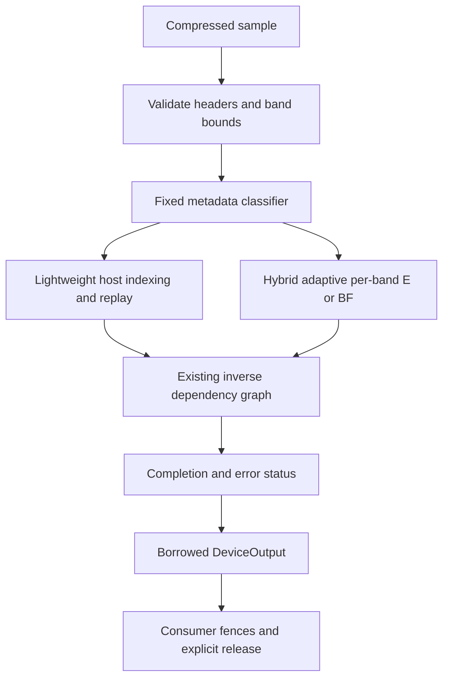

# Decode Phase 3A: production decoder core

Copyright (c) 2026 HyperCine Contributors. Dual-licensed under MIT OR Apache-2.0.

## 1. Scope and architecture

Phase 3A consolidates the audited Phase 2 decoder into `HyperCine::Decoder`, linked with `HyperCine::Decoder` in CMake. The implementation parses and validates a sample once, classifies its highpass descriptors, selects a frame strategy, reconstructs through the existing inverse dependency graph, and publishes a borrowed `DeviceOutput`. The core adds no third-party dependency and uses C++17 and the enabled native CUDA SDK.

Production output coverage is **progressive, three-channel, 10-bit YUV422** with three spatial wavelet levels, DeviceBGRA8 or reconstructed signed-16 Y/U/V planes. Geometry must be at least 64 by 64, width divisible by 16, height divisible by 8, and within the configured maximum, capped at 7680 by 4320. This is the validated coverage boundary, not a claim of support for every CineForm profile. Temporal/interlaced reconstruction is deferred. Unsupported field/temporal input returns `UnsupportedEncodingMode`.



## 2. Research inheritance and compatibility

Lightweight uses the existing D-style host-index frame-barrier mode in the E resource pool. Hybrid uses the audited full-frame FC integration with `AdaptiveDynamic`; HostStreaming exposes the exact E reference for diagnostics. A single pool holds both production strategies, avoiding a second complete decoder allocation. The independent historical D, E, FA and FC references and all previous tests remain available. No entropy algorithm was introduced.

The six phase-numbered decoder/index declaration headers now live in `include/hypercine/research/`. Their old paths forward to those declarations, preserving source compatibility and existing class symbols. Production clients include `decoder.h`. Namespace migration and shared-library ABI versioning are deferred; this remains pre-1.0 software.

## 3. Production API

`include/hypercine/decoder.h` declares `Decoder`, `DecoderConfig`, `DecoderCapabilities`, `DecodeRequest`, `DecodeTicket`, `DecodeStatus`, `DeviceOutput` and the related phase-free enums. `decoder_cuda.h` is the intentional CUDA interoperability extension. The unconditional header includes no CUDA SDK header or CUDA type.

```cpp
#include <hypercine/decoder.h>

HyperCine::DecoderConfig config;
config.maximum_width = 3840;
config.maximum_height = 2160;
HyperCine::Decoder decoder(config);
if (decoder.Initialize() != HyperCine::DecodeError::None) return;
HyperCine::DecodeError error;
auto ticket = decoder.QueueDecode(bytes, size, {}, &error);
if (!ticket) return; // Busy is retryable; no slot was consumed.
auto status = decoder.WaitForDecode(ticket);
HyperCine::DeviceOutput output;
if (status.state == HyperCine::DecodeState::Ready &&
    decoder.GetDeviceOutput(ticket, &output)) {
    // Use the device planes; register external consumer streams before use.
}
decoder.ReleaseOutput(ticket); // Also required for accepted failed tickets.
```

Input is copied into owned pinned storage during `QueueDecode`. Clients may reuse their compressed bytes when it returns. Header parsing, indexing/correction and GPU work submission occur synchronously on the caller; GPU reconstruction remains asynchronous. Queueing is therefore not a constant-time submit operation. Methods serialize on each instance's mutex. Instances are independent. Decoder objects are noncopyable and nonmovable.

## 4. Frame dispatcher

Each validated sample supplies 30 descriptors, of which 27 are highpass. Classification walks only these descriptors. Diagnostic request overrides are `Lightweight`, `Hybrid` and `HostStreaming`; normal requests use `Automatic`. Policy affects default queue depth, while frame classification remains the same under Auto, LowLatency and HighThroughput.

## 5. Fixed classification rule

The classifier records total highpass payload bytes, padded coefficient count, largest band payload, dense-band count and payload bytes per wavelet level. A band is dense when its payload is at least 32768 bytes and `bytes * 100 >= coefficients * 105`. Detail is concentrated when level 1 accounts for at least 75% of all highpass bytes. Detail is distributed enough to consider Hybrid when total payload is at least 262144 bytes and the largest band is at least 65536 bytes.

Choose Hybrid iff detail is not concentrated and either a dense band or distributed detail exists; otherwise choose Lightweight. All calculations use integer arithmetic. Equality and adjacent boundary cases call the real classifier in the regression test. No pixel scan, entropy scan, clock, previous frame, timing history, load measurement or runtime threshold training influences the decision. `classifier_nanoseconds` is an observation only.

The initial dense-only prototype performed poorly on Texture and Edges and was replaced before final measurement. The final thresholds were selected offline from the deterministic development corpus; Oracle results describe that corpus and do not establish optimality on unseen footage.

## 6. Hybrid adaptive band selection

The validated FC Method E/BF policy is retained, including correction-derived fallback. CS9 eligible bands use summaries, CPU root correction and BF replay. CS17 attempts the audited adaptive mechanism and may fall back to host Method E according to the existing content-derived full-chunk correction boundary; CS18 remains Method E. Static-only selection is not the production policy. The historical audit tests retain their equality/fallback coverage.

One existing call-site quirk matters for reproduction: the float threshold `0.05f` was passed to Resolve's integer `max_full_chunks_fallback` argument, becoming zero; the ratio argument retained its default 1.0. Production preserves that effective behavior explicitly (`threshold, 1.0f`) rather than changing the audited algorithm during consolidation. Frame and band decisions are compared independently of observed timing.

## 7. DeviceOutput

Output pointers and the ready event belong to the decoder. They must not be freed or destroyed. `planes[0]` is BGRA8 for packed output. Planar output is Y, U, V, signed int16 with effective precision 10, full-height chroma and half-width chroma; native historical channel order Y/V/U is converted in the descriptor. Pitch is in bytes and at least 16-byte aligned. Width and height describe active pixels, not row padding.

BGRA honors requested top-down/bottom-up orientation, BT601/BT709 and CG/VS conversion. Planar reconstruction is always top-down and precedes color conversion; matrix/range describe the request rather than a color transform applied to the coefficients. The descriptor carries geometry, format, precision, device ordinal, ticket and borrowed native event. It becomes invalid on explicit release, decoder release/reinitialization or destruction.

## 8. Ticket state machine

Free pool entries are represented internally by Released slots. Accepted work transitions `Queued -> Running -> Ready` or `Queued/Running -> Failed`, then explicit `ReleaseOutput -> Released`. Queued is transient inside synchronous submission. A failed ticket never becomes Ready. A released ticket may report Released until its slot is reused; after reuse it is Invalid. Tickets combine a globally unique instance generation with a monotonic request number, preventing cross-instance or post-reinitialization aliasing.

## 9. Slots and scheduling policies

Explicit slot count is bounded to 1 through 4. Zero chooses a measured policy default: Auto uses two slots, HighThroughput three, and LowLatency one. Two slots gave the highest 1080p sweep throughput and kept 97.5% of the three-slot 4K throughput with lower latency and one fewer slot's memory. Three remains the export policy candidate. The pool preallocates to configured maximum dimensions. Queue saturation returns an empty ticket and `Busy`; it leaves every held output intact. Tests hold one output while repeatedly reusing the other slot and release in non-FIFO order.

## 10. Memory ownership and consumers

Device buffers, pinned buffers, streams/events and worker threads belong to RAII implementation objects. Failed initialization releases partially acquired resources. A slot owns coefficients, inverse scratch, reconstructed planes, packed output, compressed storage, checkpoint and summary scratch. Immutable FSM tables are shared by slots within an instance, with separate immutable copies in independent instances.

`StreamWait(ticket, CudaDecodeConsumer(stream))` registers at most eight distinct, non-null consumer streams and inserts the borrowed output-ready event dependency. Registration is valid while Running or Ready. Production polling checks an event and already queued pinned status copies; it performs no blocking D2H error transfer. Clients can poll readiness and enqueue dependent consumer work without a host CUDA synchronization. Failed output is never published. All consumer work must be submitted before release; streams must remain alive until release. `ReleaseOutput` drains registered streams before slot reuse and can block. Concurrent submission after release begins is outside this ownership contract.

## 11. Failure semantics

Invalid configuration/request and saturation reject submission without a ticket. Accepted null, oversized, unsupported or malformed samples receive a Failed ticket and require release. The first terminal status is retained. Backend indexing failures drain submitted work before abandoning a backend slot. Frame error guards suppress dependent work when set; Hybrid replay status is copied asynchronously and checked before publication. Already submitted work drains, and no output descriptor is published for Failed work. Release/destruction drains pending work. Resource/device errors during asynchronous completion return `DeviceFailure`.

The strict private parser checks chunk extents, trailers, channel/subband order, geometry, supported codebooks/encoding/flags/precision and peak table bounds. Validated checkpoint generation checks termination even for tiny one-segment bands. These checks are deliberately stronger than the compatible legacy entry point.

## 12. CPU-only behavior

`HYPERCINE_ENABLE_CUDA=OFF` builds the production facade and its unconditional header. `Initialize` returns `BackendUnavailable`; malformed configuration returns `InvalidConfig`. Queueing an uninitialized decoder returns `NotInitialized`. This phase does not add a production CPU reconstruction backend. Existing CPU reference tests remain available.

## 13. Multiple instances

Two and four decoder instances use separate pools, events, worker teams and ticket generations. Independent deterministic random-access streams are validated against the CPU reference. The production facade selects its configured device on operations; CUDA consumer streams must belong to that same device. Tests ran on one GPU; multi-device validation is deferred.

## 14. Benchmark methodology and reproduction

The matrix compares independent legacy D, streaming E, audited Adaptive FC, forced production Lightweight, forced production Hybrid and production Auto. Each path receives five warmups and 120 measured 1080p frames, 60 4K frames and 30 8K Flat frames. Timing covers host Queue through Ready and Release with device-resident output; download and validation are outside these matrix windows. CPU ms/frame is process kernel plus user time across all threads, not one thread or wall time. Forced-strategy measurement order alternates by case.

Mixed streaming benchmarks warm every slot on every pattern, then decode 1000 frames per run. Queue-to-host-observed-Ready latency includes buffering and is reported separately from FPS. Independent 2/3/4 slot sweeps and one/three-slot policy defaults cover both resolutions. A separate 1000-frame 4K Noise stream measures sustained dense workload. GPU tests/benchmarks/sanitizers run sequentially for measurement isolation. Laptop clocks, thermal state and Windows scheduling can move timings; no runtime decisions depend on them.

```powershell
cmake -S . -B build -DHYPERCINE_ENABLE_CUDA=ON -DCMAKE_CUDA_ARCHITECTURES=89
cmake --build build --config Release
ctest --test-dir build -C Release --output-on-failure > build/cuda_ctest_final.txt 2>&1
.\build\tests\Release\test_decoder.exe tests/decode_phase0_golden.txt
.\build\tests\Release\test_decoder.exe tests/decode_phase0_golden.txt --longrun
.\build\benchmarks\Release\benchmark_decoder.exe 120
.\build\benchmarks\Release\benchmark_codec.exe --json benchmarks/results/decode_phase3a_codec_reference.json
cmake -S . -B build-cpu -DHYPERCINE_ENABLE_CUDA=OFF
cmake --build build-cpu --config Release
ctest --test-dir build-cpu -C Release --output-on-failure > build/cpu_ctest_final.txt 2>&1
```

All generators use seed `0x1337BEEF`. The unchanged Phase 0 manifest supplies frozen sample and output hashes. Final artifacts include source fingerprints and validation provenance. Historical result files are preserved.

## 15. Per-pattern measurements

<!-- MATRIX -->
| Frame | Auto choice | D ms | E ms | FC ms | Auto ms | Oracle ms | Auto FPS | MP/s | CPU ms/frame |
| --- | --- | --- | --- | --- | --- | --- | --- | --- | --- |
| 1920 flat | lightweight | 0.918 | 2.418 | 2.239 | 0.992 | 0.981 | 1008.3 | 2090.8 | 0.91 |
| 1920 gradient | lightweight | 2.425 | 4.603 | 2.715 | 2.714 | 2.730 | 368.5 | 764.1 | 4.17 |
| 1920 noise | hybrid | 17.001 | 16.625 | 4.952 | 4.587 | 4.593 | 218.0 | 452.1 | 12.76 |
| 1920 texture | lightweight | 7.374 | 7.541 | 7.713 | 7.454 | 7.658 | 134.2 | 278.2 | 7.55 |
| 1920 edges | hybrid | 3.782 | 7.280 | 3.471 | 3.532 | 3.691 | 283.1 | 587.0 | 6.77 |
| 3840 flat | lightweight | 1.594 | 3.201 | 3.210 | 1.543 | 1.594 | 648.2 | 5376.6 | 1.30 |
| 3840 gradient | hybrid | 4.465 | 6.843 | 4.027 | 4.121 | 4.156 | 242.7 | 2012.8 | 10.16 |
| 3840 noise | hybrid | 68.850 | 65.349 | 8.198 | 8.229 | 8.297 | 121.5 | 1008.0 | 40.89 |
| 3840 texture | lightweight | 20.057 | 20.577 | 20.438 | 19.947 | 19.525 | 50.1 | 415.8 | 21.35 |
| 3840 edges | hybrid | 9.548 | 13.357 | 5.269 | 5.063 | 5.063 | 197.5 | 1638.1 | 11.20 |
| 7680 flat | lightweight | 5.680 | 8.194 | 8.018 | 4.324 | 4.329 | 231.3 | 7673.4 | 4.69 |

The required unchanged `benchmark_codec` comparison uses the original CPU harness, separately from production GPU decoding:

| Case | Encode baseline -> current FPS | Decode baseline -> current FPS | Current encode/decode MP/s | Encode avg/min/max ms | Decode avg/min/max ms | Peak WS MiB |
| --- | --- | --- | --- | --- | --- | --- |
| 1080p | 77.70 -> 89.37 | 394.15 -> 489.05 | 185.3/1014.1 | 10.89/10.48/13.36 | 2.04/1.80/3.64 | 92.54 |
| 4K_UHD | 21.84 -> 24.10 | 125.31 -> 128.22 | 199.9/1063.5 | 40.49/38.00/42.78 | 7.80/7.31/8.89 | 229.31 |
| 8K_UHD | 4.28 -> 5.94 | 27.96 -> 28.35 | 196.9/940.5 | 165.40/143.41/199.56 | 35.28/33.19/36.97 | 614.02 |

All three current CPU encode/decode throughput measurements are at least the preserved baseline; peak working set differs by less than 0.2 MiB. This harness links the pristine SDK and does not use the new decoder facade, so its timing improvements are not attributed to Phase 3A. The GPU matrix shows modest validation/barrier overhead against standalone D on 1080p Flat/Gradient; Noise retains the Hybrid advantage and Texture avoids forced Hybrid.
<!-- END MATRIX -->

## 16. Mixed workload and scheduling

<!-- MIXED -->
| Width / workload | Slots | FPS | MP/s | Mean ready latency ms | CPU ms/frame | L/H decisions | Peak process WS MiB |
| --- | --- | --- | --- | --- | --- | --- | --- |
| 1920 equal_five_pattern | 2 | 272.20 | 564.4 | 7.343 | 14.28 | 600/400 | 232.74 |
| 1920 equal_five_pattern | 3 | 268.40 | 556.5 | 11.170 | 14.66 | 600/400 | 234.91 |
| 1920 equal_five_pattern | 4 | 264.65 | 548.8 | 15.097 | 15.42 | 600/400 | 271.54 |
| 1920 low_latency | 1 | 258.89 | 536.8 | 3.861 | 7.19 | 600/400 | 271.54 |
| 1920 high_throughput | 3 | 271.71 | 563.4 | 11.034 | 15.66 | 600/400 | 271.54 |
| 3840 equal_five_pattern | 2 | 133.90 | 1110.6 | 14.934 | 32.50 | 400/600 | 271.54 |
| 3840 equal_five_pattern | 3 | 137.40 | 1139.6 | 21.826 | 33.50 | 400/600 | 271.54 |
| 3840 equal_five_pattern | 4 | 135.81 | 1126.4 | 29.431 | 31.64 | 400/600 | 292.04 |
| 3840 low_latency | 1 | 127.86 | 1060.5 | 7.819 | 15.94 | 400/600 | 292.04 |
| 3840 high_throughput | 3 | 135.11 | 1120.7 | 22.197 | 33.00 | 400/600 | 292.04 |
| 3840 noise_sustained | 3 | 132.33 | 1097.6 | 22.646 | 36.83 | 0/1000 | 292.04 |
<!-- END MIXED -->

## 17. OracleFrame

OracleFrame is the minimum same-session mean of forced production Lightweight and Adaptive Hybrid for each frame. It is benchmark-only. Selected-strategy latency uses the corresponding forced measurement; Auto wall latency is reported separately to expose submission/measurement variation.

## 18. Regret and capture

`regret_ms = selected_strategy_mean_ms - oracle_mean_ms`. Oracle improvement capture is `(best_fixed_strategy_sum - selected_strategy_sum) / (best_fixed_strategy_sum - oracle_sum)`, with equal weight for each of the eleven cases. This is improvement over the better all-Lightweight/all-Hybrid fixed strategy, not an unlabelled FPS ratio. Per-case oracle efficiency is also reported. An Auto wall capture above 100% can result from separate timing windows; it is not an oracle violation.

<!-- ORACLE -->
Selected-strategy improvement capture: **100.00%**; Auto wall capture: 101.42%. Mean regret 0.000000 ms, worst regret 0.000000 ms, misclassifications 0/11. Observed classifier cost ranged from 100 to 300 ns per frame.
<!-- END ORACLE -->

## 19. Long-sequence and determinism stress

The long-run test executes 10000 1080p mixed frames, 5000 4K mixed frames and 1000 8K Flat frames with three slots. It cycles flat/noise/texture/edges/gradient/noise/flat, substituting deterministic random selections every seventeenth request. Every output receives a complete CPU-reference BGRA byte comparison, and every frame strategy and all 27 band decisions must match warmup baselines. Working set is sampled every 250 frames. These throughput numbers include downloads and verification and are separate from device-resident benchmarks.

Independent repeatability windows cover 200 1080p Noise, 100 4K Noise, 100 4K Texture and 20 8K Flat outputs. Tests compare bytes and frame/band decisions. Two/four instance tests run 100 independently seeded requests per instance. Lifetime tests cover pending/delayed/out-of-order/failed/double release, cross-instance rejection, reinitialization, copied input ownership, pending destruction and independent consumer streams.

<!-- LONGRUN -->
| Width | Frames | Verified FPS | First/last decile ms/frame | WS change bytes | Free VRAM change bytes | C++ / owned CUDA allocations | Result |
| --- | --- | --- | --- | --- | --- | --- | --- |
| 1920 | 10000 | 206.87 | 4.811/4.760 | 36864 | 0 | 0 / 0 | PASS |
| 3840 | 5000 | 87.28 | 11.402/11.538 | -45056 | 0 | 0 / 0 | PASS |
| 7680 | 1000 | 43.55 | 23.309/23.288 | 0 | 0 | 0 / 0 | PASS |
<!-- END LONGRUN -->

## 20. Malformed samples and real difference coding

The bounded seed-driven corpus runs 1000 deterministic mutations plus five dedicated null/capacity/reserved-flags/interlaced/LL-chunk submissions (1005 total). A direct validated-index check also proves coefficient-overflow rejection. Mutations include truncation, zeroed entropy, missing trailer, invalid subband header, undersized sample, invalid frame/LL/band geometry, invalid codebook, unsupported temporal transform, invalid chunk extent and a difference-coded flag with invalid entropy. Each accepted failure must preserve its first error, publish no output, release safely and permit subsequent valid work. This is bounded robustness evidence, not a security certification or detection of every corrupted payload. Valid LL words and other syntactically valid coefficient changes cannot universally be detected without an integrity checksum.

**Real difference-coded entropy/coefficient validation — interlaced output reconstruction deferred.** The unchanged upstream encoder generates the audited interlaced YUY2 Noise fixture. The parser identifies its real difference-coded bands. All 30 E and Adaptive Hybrid bands match the single-worker CPU coefficient reference with maximum error zero. Production rejects the fixture with `UnsupportedEncodingMode` and publishes no output. No progressive BGRA or planar comparison is required or fabricated for this fixture.

This stronger CPU comparison uncovered a pre-existing omission: GPU references had ignored the sample's peak escape table; previous E/FC comparisons agreed with each other but differed from the CPU. A bounded metadata restoration replaces dequantized peak escape values before the existing horizontal difference operation, matching upstream ordering. It changes no VLC algorithm, encoder, bitstream or inverse transform. The regression exercises the restoration against CPU coefficients. Full interlaced/field-aware inverse reconstruction belongs in Phase 3B. An optional unchanged-encoder YUY2 Noise probe with interlaced encoding disabled found no genuinely progressive difference-coded sample; it does not block this phase.

## 21. Compute Sanitizer

Each of initcheck, memcheck, racecheck and synccheck runs the production regression's `--sanitizer` window: two slots, delayed output, polling and two consumer streams, 36 malformed mutations plus five dedicated cases (41 submissions), two/four instances with five requests each, real difference coefficient validation, short 1080p/4K deterministic windows and a ten-frame steady-state allocation window after all strategies warm. The expensive eleven-frame golden matrix and 8K repeats run outside instrumentation. Logs and exit codes are retained.

```powershell
compute-sanitizer --tool memcheck --error-exitcode 99 --log-file benchmarks/results/decode_phase3a_memcheck.txt .\build\tests\Release\test_decoder.exe tests/decode_phase0_golden.txt --sanitizer
```

Replace `memcheck` in both positions for the other three tools. Instrumented tests should run from an isolated working directory so their focused JSON does not replace the full validation artifact; use absolute executable/manifest/log paths in that case. For the artifact summarizer's exact directory convention:

```powershell
$decodeRoot = (Get-Location).Path
$decodeSanDir = Join-Path $decodeRoot 'build/decoder-sanitizers'
New-Item -ItemType Directory -Force -Path $decodeSanDir | Out-Null
$decodeExe = Join-Path $decodeRoot 'build/tests/Release/test_decoder.exe'
$decodeManifest = Join-Path $decodeRoot 'tests/decode_phase0_golden.txt'
Push-Location $decodeSanDir
try {
    foreach ($decodeTool in @('initcheck','memcheck','racecheck','synccheck')) {
        $decodeLog = Join-Path $decodeRoot "benchmarks/results/decode_phase3a_${decodeTool}.txt"
        compute-sanitizer --tool $decodeTool --error-exitcode 99 --log-file $decodeLog $decodeExe $decodeManifest --sanitizer > "${decodeTool}_stdout.txt" 2>&1
        $decodeExit = $LASTEXITCODE
        Set-Content -Path "${decodeTool}_exit.txt" -Value $decodeExit
        if ($decodeExit -ne 0) { throw "$decodeTool failed: $decodeExit" }
    }
} finally { Pop-Location }
python benchmarks/summarize_decode_phase3a.py
```

The first restricted-runner initcheck attempt could not attach to the target. All four recorded final runs used native Windows process attachment and completed successfully. The summarizer requires successful full CTest logs and a full-mode validation artifact; it refuses to promote a focused sanitizer artifact to full validation.

<!-- SANITIZERS -->
| Tool | Exit | Errors / hazards | Log |
| --- | --- | --- | --- |
| initcheck | 0 | 0 / 0 | [decode_phase3a_initcheck.txt](../benchmarks/results/decode_phase3a_initcheck.txt) |
| memcheck | 0 | 0 / 0 | [decode_phase3a_memcheck.txt](../benchmarks/results/decode_phase3a_memcheck.txt) |
| racecheck | 0 | 0 / 0 | [decode_phase3a_racecheck.txt](../benchmarks/results/decode_phase3a_racecheck.txt) |
| synccheck | 0 | 0 / 0 | [decode_phase3a_synccheck.txt](../benchmarks/results/decode_phase3a_synccheck.txt) |
<!-- END SANITIZERS -->

## 22. Memory accounting

GPU and pinned numbers sum requested owned buffers using their actual allocation pitches and configured maximum geometry. They exclude CUDA context/driver allocations and opaque stream/event storage. Pageable capacity is a known decoder vector/object capacity estimate, excluding worker-pool implementation heap, thread stacks, allocator overhead and driver/runtime state. Peak working set is the process cumulative high-water mark and includes test samples/reference objects; it is not decoder-only RAM. Global free VRAM is a device-wide observation and is reported separately from owned VRAM.

Each slot reserves a 32-MiB compressed upload on device and pinned host, bounded checkpoint/summaries, and 27 reusable root-correction vectors of 131072 restart entries each. This deliberate pageable-capacity cost avoids content-dependent growth after warmup. The allocation counter reports successful owned CUDA buffer allocations: one immutable table per instance and 57 device plus six pinned allocations per slot. All owned CUDA allocation sites are confined to initialization. The C++ counter separately instruments global new/new[] during closed steady-state windows; it does not measure driver, CRT or upstream allocations. Exception/error recovery is outside the allocation-free steady-state windows.

<!-- MEMORY -->
| Configured width | Slots | Owned VRAM MiB | VRAM per slot MiB | Pinned MiB | Known pageable capacity MiB | Owned CUDA allocation calls |
| --- | --- | --- | --- | --- | --- | --- |
| 1920 | 2 | 139.69 | 69.77 | 69.09 | 81.37 | 127 |
| 1920 | 3 | 209.46 | 69.77 | 103.64 | 121.98 | 190 |
| 1920 | 4 | 279.23 | 69.77 | 138.18 | 162.59 | 253 |
| 3840 | 2 | 348.58 | 174.22 | 69.09 | 81.37 | 127 |
| 3840 | 3 | 522.80 | 174.22 | 103.64 | 121.98 | 190 |
| 3840 | 4 | 697.02 | 174.22 | 138.18 | 162.59 | 253 |

Each instance owns 150016 bytes of immutable device FSM tables and 150016 bytes of host tables. Pinned memory per slot is 36224368 bytes (34.55 MiB). Known pageable capacity is roughly 40.61 MiB per slot plus instance objects; most of it is the conservative root reservation. These capacities remain stable after warmup.
<!-- END MEMORY -->

## 23. Public research interfaces and build boundaries

`research/decode_phase2a.h`, `decode_phase2b.h`, `decode_phase2c.h`, `decode_phase2d.h`, `decode_phase2e.h` and `decode_gpu_index.h` contain historical declarations. Original paths remain compatible forwarders. The production library's public surface is the phase-free facade; its private static implementation dependency does not require clients to compile against those declarations. Static archives pull referenced objects rather than every historical benchmark target. The shared E implementation still contains its legacy symbols; exhaustive binary hiding requires later archive/shared-library separation.

`decode_entropy_cuda.h`, `decode_color_cuda.h` and `decode_inverse_cuda.h` remain public low-level implementation/kernel interfaces with intentional CUDA types. Production consumers use the opaque main header and optional CUDA extension. Early `phase2a.h`, `phase2a_gpu.h`, `phase2b.h`, `phase2c.h`, `phase2d.h` and existing encoder `phase3a.h` belong to encoder research and are unchanged. Moving those would broaden this decoder-only phase and is deferred. Historical FA/FB research and benchmark targets remain separate and callable.

## 24. Phase 3B recommendations

Next establish a profile/format capability matrix and implement field-aware interlaced inverse reconstruction with real difference-coded end-to-end vectors. Extend coverage deliberately to 8/10/12-bit profiles, RGB444/RGBA4444 and additional output precision with frozen CPU references. Validate held-out camera footage and generalize dispatch only with offline evidence. Reduce the conservative root-vector reservation, audit worker/driver memory in greater detail and separate remaining low-level/research headers and binary symbols. Graphics interop and FFmpeg integration follow coverage work; none was implemented here.

## 25. Promotion recommendation and completion report

<!-- REPORT -->
Recommend review for promotion of the progressive YUV422 decoder. Exactness, dispatch, stress, malformed input, sanitizer and memory gates pass within the tested scope. Main remains unchanged. Interlaced output is expressly deferred by the user's scope clarification. The classifier remains development-corpus evidence; held-out footage and full profile coverage belong to the next phase.

| # | Completion item | Result |
| --- | --- | --- |
| 1 | Branch | decode-phase3a |
| 2 | Base commit | dded4d8ae61800241164499fa875c0cb104281a4 |
| 3 | Commits created | d24325f test(decoder): add production stress and oracle benchmarks; 2f5314a feat(decoder): consolidate production API and deterministic dispatch; docs(decoder): document Phase 3A production architecture and evidence (contains this report) |
| 4 | Files changed | 49 files; see decode_phase3a_completion.json for the complete path list |
| 5 | Upstream status | Pristine; tree equals the frozen upstream baseline; status empty |
| 6 | Encoder status | Sources, headers and behavior unchanged; benchmark_codec baseline preserved |
| 7 | Production API | HyperCine::Decoder, HyperCine::Decoder CMake target |
| 8 | Public headers added | decoder.h, decoder_cuda.h |
| 9 | Research headers internalized | Six decoder/index declarations under research/, old paths compatible |
| 10 | Research headers still public | Low-level entropy/color/inverse CUDA; encoder phase2 prototypes; compatibility forwarders |
| 11 | DeviceOutput contract | Borrowed pointers/pitches/geometry/format/orientation/ticket/event; valid until explicit release |
| 12 | Ticket lifecycle | Queued -> Running -> Ready/Failed -> Released; generation identity; Busy consumes no slot |
| 13 | Error lifecycle | First terminal error retained; no output on failure; drain/reuse; UnsupportedEncodingMode for interlaced/temporal |
| 14 | Default slots | Auto 2; LowLatency 1; HighThroughput 3; explicit 1..4 |
| 15 | Memory per slot | 1080p/4K VRAM 69.77/174.22 MiB; pinned 34.55 MiB; known pageable ~40.61 MiB |
| 16 | VRAM per Auto decoder | 1080p/4K 139.69/348.58 MiB |
| 17 | Pinned memory per Auto decoder | 69.09 MiB |
| 18 | Auto classifier design | Fixed integer dense/distributed/concentrated rule; no runtime learning |
| 19 | Classifier inputs | 27 header descriptors: payload sizes, coefficient counts and level distribution |
| 20 | Classifier cost | 100..300 ns observed |
| 21 | Decisions by pattern | 1080p: Flat/Gradient/Texture L, Noise/Edges H; 4K: Flat/Texture L, Gradient/Noise/Edges H; 8K Flat L |
| 22 | Adaptive band policy | Audited AdaptiveDynamic E/BF retained, including content-derived fallback and effective call boundary |
| 23 | Oracle methodology | Minimum same-session mean of forced production L/H, not a runtime decision |
| 24 | Oracle improvement capture | 100.00%; Auto wall 101.42% |
| 25 | Worst regret | 0.000000 ms; mean 0.000000; 0/11 misses |
| 26 | 1920 flat | 0.992 ms, 1008.32 FPS, lightweight |
| 27 | 1920 gradient | 2.714 ms, 368.51 FPS, lightweight |
| 28 | 1920 noise | 4.587 ms, 218.02 FPS, hybrid |
| 29 | 1920 texture | 7.454 ms, 134.16 FPS, lightweight |
| 30 | 1920 edges | 3.532 ms, 283.09 FPS, hybrid |
| 31 | 3840 flat | 1.543 ms, 648.21 FPS, lightweight |
| 32 | 3840 gradient | 4.121 ms, 242.67 FPS, hybrid |
| 33 | 3840 noise | 8.229 ms, 121.53 FPS, hybrid |
| 34 | 3840 texture | 19.947 ms, 50.13 FPS, lightweight |
| 35 | 3840 edges | 5.063 ms, 197.50 FPS, hybrid |
| 36 | 7680 flat | 4.324 ms, 231.28 FPS, lightweight |
| 37 | 1080p mixed Auto (2 slots) | 272.20 FPS, 7.343 ms ready latency, 14.28 process CPU ms/frame |
| 38 | 4K mixed Auto (2 slots) | 133.90 FPS, 14.934 ms ready latency, 32.50 process CPU ms/frame |
| 39 | 4K Noise sustained | 132.33 FPS, 22.646 ms ready latency, 36.83 process CPU ms/frame |
| 40 | Optimal slot count | 2 highest 1080p sweep FPS; 3 highest 4K sweep FPS; balanced Auto 2 |
| 41 | LowLatency | 1080p 258.89 FPS, 3.861 ms ready latency, 7.19 process CPU ms/frame; 4K 127.86 FPS, 7.819 ms ready latency, 15.94 process CPU ms/frame |
| 42 | HighThroughput | 1080p 271.71 FPS, 11.034 ms ready latency, 15.66 process CPU ms/frame; 4K 135.11 FPS, 22.197 ms ready latency, 33.00 process CPU ms/frame |
| 43 | CPU ms/frame | Process-wide CPU time, matrix and mixed rows above; throughput policies have higher CPU cost than LowLatency |
| 44 | Long-run 1920 | 10000 fully byte-verified frames PASS; 206.87 verified FPS |
| 45 | Long-run 3840 | 5000 fully byte-verified frames PASS; 87.28 verified FPS |
| 46 | Long-run 7680 | 1000 fully byte-verified frames PASS; 43.55 verified FPS |
| 47 | Random access | Seeded independent selection and periodic seek-like substitutions PASS |
| 48 | Two decoders | 2 x 100 independent random requests, CPU-exact PASS |
| 49 | Four decoders | 4 x 100 independent random requests, CPU-exact PASS |
| 50 | Output lifetime | Delayed/out-of-order/pending/failed/double release, reinit and destruction; two consumer streams PASS |
| 51 | Queue saturation | Busy, held output unchanged, released slot reusable PASS |
| 52 | Real difference coding | Interlaced fixture: 30/30 CPU/E/Hybrid coefficients exact, max error 0; production deliberately rejects; interlaced output deferred |
| 53 | Malformed corpus | 1005 rejected submissions; explicit coefficient-overflow and LL bounds checks PASS |
| 54 | Mutation stress | 1000 seeded bounded mutations; no false Ready, first failure retained, release/reuse PASS |
| 55 | initcheck | Exit 0; zero errors/hazards |
| 56 | memcheck | Exit 0; zero errors/hazards |
| 57 | racecheck | Exit 0; zero errors/hazards |
| 58 | synccheck | Exit 0; zero errors/hazards |
| 59 | CUDA CTest | 31/31 PASS in 688.74 s |
| 60 | CPU-only CTest | 6/6 PASS in 4.58 s |
| 61 | Determinism | 200 Noise1080 / 100 Noise4K / 100 Texture4K / 20 Flat8K; bytes and frame/band decisions identical |
| 62 | Memory growth/leaks | Owned capacities/free VRAM stable; working set snapshots plateau; zero steady-state C++ and owned CUDA allocations |
| 63 | Recommended policy | Auto with 2 slots; LowLatency interactive; HighThroughput 3 slots when throughput justifies memory/CPU/latency |
| 64 | Ready for main | Recommend review for progressive YUV422 promotion; all Phase 3A gates pass within stated corpus/scope; no merge/tag/push performed |
| 65 | Phase 3B | Field-aware interlaced inverse and profile capability matrix, then 8/10/12-bit and RGB/RGBA coverage with frozen vectors |
<!-- END REPORT -->
