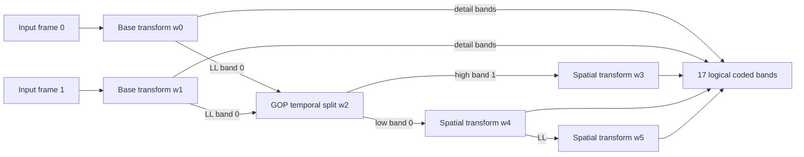
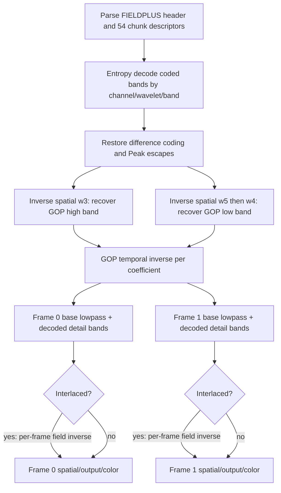

# Decode Phase 3B-2R: FIELDPLUS/GOP-2 reference model

SPDX-License-Identifier: MIT OR Apache-2.0

## Scope and disposition

This is a research-only result on branch `decode-phase3b2r`, based on Phase
3B-1 commit `f1d0fe4`. No production decoder, encoder, public API, or upstream
file was changed. Production still rejects FIELDPLUS before allocating its
production band layout. No CUDA temporal kernel or optimization is included.

**Outcome A — reference model complete for implementation planning.** The
unchanged upstream CPU decoder is the exact output oracle: separate frame 0 and
frame 1 BGRA and YU64 output-word hashes are frozen for both canonical samples,
four small stress vectors, and two 1080 probes. The test also freezes hashes of
all decoded signed coefficient bands available at the upstream hook. The
upstream library does not expose the final signed reconstructed planes or the
separate GOP low/high intermediate arrays through this hook, so those particular
intermediates are not claimed as captured arrays. Future GPU work can compare
decoded coefficient banks and exact final frames against the frozen oracle.

## Existing baseline and profile definitions

The production support baseline remains progressive YUV422 p10 and GOP-1
interlaced YUV422 p10. The two target profiles are both `FIELDPLUS / 2`, two
frames per sample, 10-bit coded precision, YUV 4:2:2, three channels and six
wavelets. Progressive encode flags are `2`; interlaced flags are `3`. The
interlaced header has no progressive flag and carries difference-coded logical
subbands 12 and 15 for each of Y, V and U.

| Property | Progressive FIELDPLUS | Interlaced FIELDPLUS |
|---|---|---|
| GOP length | 2 | 2 |
| Per-frame base transform | spatial | horizontal plus within-frame field temporal transform |
| GOP transform | two-band temporal transform on base LLs | same GOP transform on each base LL |
| Extra per-frame field inverse | none | after GOP temporal inverse |
| Difference-coded bands | none observed | 12 and 15 in each channel |

## Fixtures and evidence

The canonical Phase 3B-0 fixtures were used unchanged. Their SHA-256 values are
progressive `F5431C6BB8785CD03B3876F209FFA60E21838D054E5681B7F7B4CF1BCB679FFC`
and interlaced `278CED8819F3C726A242523EAD5CA6A57F45969E304A5ED99F28E2734AE16FF6`.
The frozen generated vectors and deterministic recipes are listed in
[`tests/fixtures/phase3b2r/README.md`](../tests/fixtures/phase3b2r/README.md).
1080 samples are generated reproducibly by the same probe but remain in the
ignored build directory; their hashes, sizes, encoder settings and output
references are in `decode_phase3b2r_practical_fixtures.json` and
`decode_phase3b2r_reference_frames.json`.

The patterns are intentionally distinct: asymmetric sparse-dark/bright-detailed
frames; translated box and moving edge; strong U/V change with patterned luma;
and interlaced parity-specific Y/U/V patterns that also change between GOP
frames. These test frame order, temporal roles, chroma and field parity.

## Six wavelets

Channel order is confirmed from upstream transform construction and decoded
channel data: channel 0 = Y, channel 1 = V, channel 2 = U. Chroma is half the
luma width and has the same height at every corresponding stage. Temporal
processing is coefficient-wise at each channel's own geometry.

| Index | Progressive role | Interlaced role | Content |
|---:|---|---|---|
| 0 | Frame 0 spatial base transform | Frame 0 horizontal + within-frame field temporal base | Frame 0 detail bands; LL is input to GOP split |
| 1 | Frame 1 spatial base transform | Frame 1 horizontal + within-frame field temporal base | Frame 1 detail bands; LL is input to GOP split |
| 2 | GOP temporal transform | Same GOP temporal transform after per-frame base transforms | band 0 = temporal low (sum); band 1 = temporal high (difference) |
| 3 | Spatial transform of wavelet 2 band 1 | Same transform of the GOP high branch | Four spatial bands of temporal highpass |
| 4 | First spatial transform of wavelet 2 band 0 | Same transform of GOP low branch | Three coded detail bands; LL feeds wavelet 5 |
| 5 | Second spatial transform of wavelet 4 band 0 | Same transform of GOP low branch | Final four-band low branch; band 0 is deepest LL |

The first two transforms are created while preparing each input frame. The
GOP temporal split is then applied to wavelet 0 band 0 and wavelet 1 band 0.
Three spatial transforms are used in total: the base transforms (one each for
the input frames), one on temporal highpass, and two nested transforms on
temporal lowpass. The 17 coded logical bands include only the bands needed to
rebuild those six wavelet objects; intermediate LLs are routed into the next
transform rather than emitted as independent coded bands.

At 64×64, luma dimensions are 32×32 for wavelets 0–2, 16×16 for 3–4 and 8×8
for 5. U/V are 16×32, 8×16 and 4×8 respectively. At 1920×1080 the corresponding
luma sizes are 960×540, 480×270 and 240×135; U/V are 480×540, 240×270 and
120×135. The complete machine map is in `decode_phase3b2r_wavelets.json` and
`decode_phase3b2r_subbands.json`.

## Logical subband map and physical chunks

The mapping below is the same logical map in each profile. Per-channel
dimensions follow the owning wavelet. “HL” is upstream band 2 (highpass of the
lowpass intermediate); “LH” is band 1; “HH” is band 3. Band 0 is LL.

| Logical subband | Owner band | Level | Temporal/frame association | Meaning |
|---:|---|---:|---|---|
| 0 | w5 / LL (band 0) | 3 | GOP lowpass | deepest lowpass coefficients |
| 1 | w5 / LH (band 1) | 3 | GOP lowpass | deepest spatial detail |
| 2 | w5 / HL (band 2) | 3 | GOP lowpass | deepest spatial detail |
| 3 | w5 / HH (band 3) | 3 | GOP lowpass | deepest spatial detail |
| 4 | w4 / LH (band 1) | 2 | GOP lowpass | middle-level spatial detail |
| 5 | w4 / HL (band 2) | 2 | GOP lowpass | middle-level spatial detail |
| 6 | w4 / HH (band 3) | 2 | GOP lowpass | middle-level spatial detail |
| 7 | w3 / LL (band 0) | 1 | GOP highpass | lowpass of spatially transformed temporal difference |
| 8 | w3 / LH (band 1) | 1 | GOP highpass | highpass spatial detail of temporal difference |
| 9 | w3 / HL (band 2) | 1 | GOP highpass | highpass spatial detail of temporal difference |
| 10 | w3 / HH (band 3) | 1 | GOP highpass | highpass spatial detail of temporal difference |
| 11 | w1 / LH (band 1) | 1 | frame 1 detail | frame 1 base-transform detail |
| 12 | w1 / HL (band 2) | 1 | frame 1 detail | frame 1 base-transform detail; interlaced difference-coded |
| 13 | w1 / HH (band 3) | 1 | frame 1 detail | frame 1 base-transform detail |
| 14 | w0 / LH (band 1) | 1 | frame 0 detail | frame 0 base-transform detail |
| 15 | w0 / HL (band 2) | 1 | frame 0 detail | frame 0 base-transform detail; interlaced difference-coded |
| 16 | w0 / HH (band 3) | 1 | frame 0 detail | frame 0 base-transform detail |

Subbands 0–3 use wavelet 5 geometry; 4–6 use wavelet 4; 7–10 use wavelet 3;
11–13 use wavelet 1; and 14–16 use wavelet 0. The 51 logical coefficient
chunks are physically serialized in channel order Y, V, U. Each channel has
18 physical chunks: subbands 0–10, one index-255 empty-band control, then
subbands 11–16. Thus `3 × 18 = 54` physical chunks, including 51 coefficient
chunks and three empty-band controls. For per-channel index `j`, subbands 0–10
use physical channel index `j = subband`; the control is index 11; subbands
11–16 use physical channel index `subband + 1`.

Each index-255 record is an 8-byte chunk with zero entropy payload. It is placed
after subband 10 in its channel and targets band 1 of the wavelet-2 temporal
object. The upstream writer emits it with `EncodeEmptyQuantBand`; the reader
recognizes index 255, validates the temporal highpass destination, establishes
the wavelet/band metadata, reads scale and quantization, consumes the empty band
trailer, and advances to logical subband 11. It does not decode coefficient
values. Those highpass coefficients are reconstructed by inverse spatial w3
from coded subbands 7–10. The index-255 record is structural transform
bookkeeping, not padding or the encoded GOP highpass coefficient payload.

`decode_phase3b2r_chunks.json` contains the exact 54 parsed chunk records for
each of the ten profile/quality probes, including physical order, payload bytes,
codebook, difference bit and Peak level. The index-255 control keeps the prior
coding flags and carries no coded coefficient table.

## Forward and inverse transforms

Upstream forward path (`FinishFieldPlusTransform`, `TransformForwardTemporal`):



For interlaced input, `w0` and `w1` each include the frame's horizontal/spatial
base and within-frame field temporal transform before the GOP transform. It is
not the GOP transform itself. The GOP transform is then exactly the same
two-frame split on the two base LL bands.

Inverse dependency order is: parse/entropy-decode all bands; inverse spatial
wavelet 3 to recover wavelet-2 band 1; inverse wavelet 5 then wavelet 4 to
recover wavelet-2 band 0; inverse GOP temporal transform to restore wavelet-0
and wavelet-1 band 0; then independently inverse each frame's base transform.
For progressive, that final per-frame operation is the spatial inverse. For
interlaced, it includes the within-frame field temporal inverse and row
interleaving, followed by the spatial/output reconstruction. The two final
frames are output in input order. This proves the requested ordering is
**entropy → spatial inverse of GOP high/low branches → GOP temporal inverse →
per-frame spatial inverse (and, for interlaced, per-frame field reconstruction)
→ output/color conversion**. Field combine does not precede GOP temporal
inverse and is not performed separately on temporal low/high branches.

The upstream frame-index renderer `ReconstructSampleFrameToBuffer` renders
index 0 or 1 after a single sample decode. `CFHD_DecodeSample`'s normal public
call renders frame 0; research calls the internal frame-index renderer for
frame 1. Both outputs require the single sample's low and high branches.

## Exact GOP temporal arithmetic and boundaries

For each signed 16-bit coefficient position, the forward split is:

```text
low  = sat16(frame0 + frame1)
high = sat16(frame1 - frame0)
```

With quantization 1 for both temporal bands, upstream inverse computes:

```text
frame0 = arshift1(sat16(low - high))
frame1 = arshift1(sat16(low + high))
```

The vector path uses signed saturating 16-bit subtract/add followed by arithmetic
right shift by one. That shift rounds negative odd values toward negative
infinity (`-1 >> 1 == -1`). The scalar tail uses C integer division, which
truncates negative odd values toward zero; it is a distinct upstream tail
behavior. The phase test covers vector-compatible math and saturating boundary
cases. Production CUDA implementation must match the SIMD path for aligned
widths and must deliberately match/reference the scalar tail where a tail is
possible. The tested p10 dimensions are vector aligned. Arithmetic intermediates
are signed 16-bit with saturation at each add/sub; there is no 10-bit clamp at
this temporal step. Output conversion applies final format-specific handling.
There is no 8-bit half-tone in this two-band inverse and no special GOP endpoint
filter: every coefficient uses both frames in the sample. The transform has no
cross-row neighbor dependency. Chroma runs independently at half width.

`decode_phase3b2r_temporal_math.json` records the formulas and 11 direct unit
vectors, plus the forward/inverse pair. The signed-tail discrepancy is retained
as an upstream behavior to resolve explicitly in a future CUDA acceptance test,
not hidden by the scalar reference helper.

## Interlaced fields, difference coding and Peak

Interlaced sample frame preparation performs the GOP temporal split on the two
frames' base LLs, which already represent that frame's field-horizontal base
transform. GOP inverse first restores one LL band to each frame. The base
interlaced inverse then combines the frame's even/odd field values and writes
them into alternating output rows (even field at the first row, odd field at
the next, using the upstream frame's stored pitch). This is per frame after GOP
inverse. GOP-1's field inverse machinery is conceptually reusable, but FIELDPLUS
must feed it restored per-frame LL and preserve the additional GOP dependency.
Field row parity and chroma parity are present in the frozen interlaced stress
fixture and its separate frame references.

For interlaced FIELDPLUS, difference coding is set on subbands 12 and 15 for
all three channels. They map to HL/band 2 of w1 (frame 1) and w0 (frame 0),
respectively. They are spatial detail bands from each frame's base transform,
not GOP temporal-high bands. Decoder restores the row-wise differential coding
before coefficient reconstruction. The encoder selects codebook 2 and enables
Peak coding for these bands; the corpus observes actual Peak level 1000 at
channel V/U subbands 12/15 in the FilmScan3 interlaced probe. Other quality
probes do not report a Peak level. The source selects this special interlaced
code path; the likely entropy-efficiency motive is an inference, not a claimed
format guarantee.

Across all ten probes, chunk count remains 54 and the three controls remain.
Progressive uses codebooks 0 and 1 and no difference coding. Interlaced uses
codebooks 0, 1 and 2 and difference-codes 12/15. Layout is stable across Low,
Medium, High, FilmScan1 and FilmScan3. Only interlaced FilmScan3 in this corpus
reports nonzero Peak levels. Low-quality sample byte sizes vary slightly across
some repeated encodes; structural results are stable, so probe binary hashes
are not treated as acceptance criteria.

## Reference results and output semantics

`decode_phase3b2r_reference_frames.json` stores independent frame hashes for
both canonical Phase 3B-0 fixtures and all four frozen 64×64 stress vectors.
It includes primary BGRA output hashes and supplementary hashes over
deinterleaved Y/U/V words from upstream YU64 output. The file also records
signed-i16 hashes for every decoded coefficient band that the upstream hook
exposes. These are hashes rather than full arrays. YU64 is supplemental; BGRA
is the display/output oracle. The target-specific lowpass offsets already in the
HyperCine parser are `+24` for BGRA8 and `+4` for planar/other targets, applied
by the existing parser/kernel contract. FIELDPLUS is rejected before those
descriptors reach production decode, and this research hook does not isolate
the post-inverse lowpass array before format conversion. Therefore the values
are documented as existing GOP-1 dispatch policy, not proven FIELDPLUS values.
Future FIELDPLUS wiring must compare BGRA and planar outputs separately and
prove the offset at the final lowpass stage.

The practical references are 1920×1080 progressive motion and 1920×1080
interlaced parity/motion probes, both FilmScan3. Sample sizes are 718,396 and
1,909,384 bytes. Their sample and source hashes and the separate frame 0/frame 1
BGRA and Y/U/V output hashes are in the two results files above. The precise
hash convention is FNV-1a 64 over active rows/words, seed `14695981039346656037`.

The bitstream `FRAME_NUMBER` field is a sequence/frame number, not PTS/DTS.
The CFHD sample contains no presentation timestamps. Container/host timing must
associate two frame times with the two outputs. The sample contains all data
needed for both images and decodes independently once available; no preceding
or following sample is required. This supports random access at sample/GOP
boundaries, with frame stepping requiring selection of index 0 or 1 within that
sample. Display order is the encoded pair order shown by upstream, but external
container timing remains authoritative for presentation.

## Entropy reuse, buffers and future GPU DAG

The existing CPU VLC/FSM primitives support the observed codebooks 0/1/2,
Peak restoration, and difference restoration. Payload framing is the existing
chunk framing. The special empty chunk needs a descriptor/control path rather
than entropy decode. These are research findings only; the production parser
still assumes the existing GOP-1 layout and must not be stretched into a fake
30-band mapping.

Recommended future descriptor minimum: profile and channel; wavelet index and
band; logical subband and physical chunk index; width/height/stride; temporal
role and frame association; low/highpass class; codebook; difference flag; Peak
table/level; payload offset/length; and empty-control kind. The parser should
produce six wavelet descriptors per channel, 17 logical bands per channel, plus
the per-channel empty temporal-high control, and identify two output frames.



Both temporal branches must be ready before either frame's base LL is restored.
Output color work for frame 0 and frame 1 can proceed independently after each
frame's spatial/field inverse. Both output surfaces coexist only if the API
requests/publishes both at once; sequential frame-index rendering can reuse a
single output surface after the shared coefficient/intermediate lifetime is
managed.

Estimated active signed-i16 coefficient storage is 6.125 words per luma pixel
for YUV422, or 12.25 bytes/pixel: 25,401,600 B (24.22 MiB) at 1080p and
101,606,400 B (96.90 MiB) at 4K. Two BGRA output surfaces add 15.82 MiB / 63.28
MiB, for 40.05 MiB / 160.18 MiB combined active storage. This is a lower bound:
it excludes row alignment, entropy/checkpoint state, temporary inverse buffers,
color scratch and allocator overhead. It is not a production allocation plan.

| Component | Reuse assessment |
|---|---|
| Header/chunk parser | Parameterize/redesign for 6 wavelets, 17 bands, 54 chunks and control chunks |
| VLC/FSM entropy decode | Reusable for observed codebooks; needs descriptor routing |
| Checkpoint/scheduler | Reusable after wavelet/band dependencies are generalized |
| Peak restoration | Reusable with codebook-2 descriptor and exact Peak table delivery |
| Difference restoration | Reusable; apply to subbands 12/15 before inverse transforms |
| Spatial inverse | Reuse kernels; schedule new w3/w4/w5 graph and frame-specific base inverse |
| GOP-1 field inverse | Reuse after GOP temporal inverse for each frame; validate parity/chroma |
| GOP temporal inverse | New kernel required |
| Color conversion | Likely reusable once final planes/offsets match; FIELDPLUS validation remains |
| Slot buffers | Redesign/size for 6 wavelets, two frames and larger coefficient footprint |
| Scheduler | Parameterize to block each frame on shared GOP dependencies |
| Ticket API | Extend semantics; do not publish one sample as a single ambiguous frame |

## API and implementation recommendation

The present one-sample/one-ticket/one-frame API does not express both outputs.
Recommend **Option C: caller requests a frame index** for a decoded sample,
while preserving the current default/index 0 behavior for GOP-1. It provides
explicit ownership and natural frame stepping, fits NLE random access, and
allows the container caller to attach the correct per-frame timestamps. Option
A's one call returning two outputs complicates ownership/lifetime; Option B
requires two tickets sharing one input sample and synchronized resource lifetime;
Option D hides indexing/order in a stateful queue and complicates seek/reset.
This is a recommendation only; no API was changed.

Progressive and interlaced paths share parsing, entropy, GOP high/low spatial
inverse, and GOP temporal inverse. Interlaced adds a per-frame base field
transform and inverse, special difference/Peak handling on two bands, and
parity-sensitive plane/output checks. Recommend **Plan 2**: 3B-2A progressive
FIELDPLUS first, then 3B-2B interlaced FIELDPLUS. This limits the first feature
to the common GOP DAG and makes a stable stage oracle available before adding
field semantics.

## Acceptance gates for the implementation phase

1. Keep all five non-target production rejection cases (FIELDPLUS progressive,
   FIELDPLUS interlaced, RGB444, RGBA4444, Bayer) intact until the feature is
   implemented.
2. Parse all three channels, 17 logical bands, the 3 empty controls and 54
   physical chunks; match the frozen per-band signed-i16 hashes where available.
3. Match frame 0 and frame 1 BGRA hashes separately on canonical 64×64,
   asymmetric, motion and chroma vectors; do the same for interlaced parity
   references before enabling it.
4. Match both 1080 practical hashes exactly; preserve output order and ensure no
   preceding/following sample is needed.
5. Test temporal vector saturation, negative odd rounding, vector-aligned width
   and scalar-tail behavior against upstream; decide explicitly how to match
   the current scalar tail's truncation discrepancy.
6. Prove BGRA/planar lowpass offsets at the final reconstructed lowpass stage;
   then compare the production color converter against the BGRA oracle.
7. Keep each public API change and production acceptance separate from this
   research commit. No merge, push or tag is part of 3B-2R.

The research test target is `test_decode_phase3b2r`; its CTest cases exercise
the temporal arithmetic and frozen CPU output oracle. Both passed. In the
39-test full CTest attempt, tests 1–11 and 13–14 passed, while the existing
Phase 3B-1 5,000-case stress test timed out after printing progress through
4,995 cases. A supplementary run of tests 15–39 stalled on `test_decode_phase2fa`
without log progress and was interrupted after more than six minutes; its
recorded prior runtime is about 33 seconds. The repository's earlier baseline
run before these research changes passed 37/37 tests in 756 seconds. The timeout
and interrupted run are recorded in `decode_phase3b2r_completion.json`; there
is no claim that the current full suite completed cleanly.
