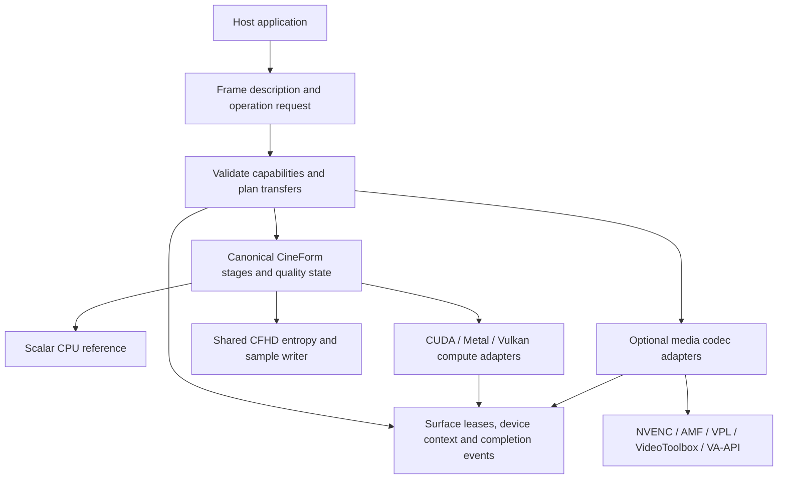
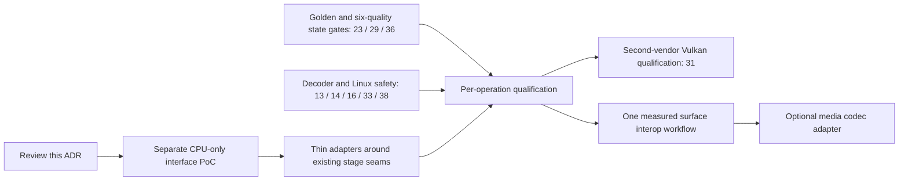

<!-- Copyright (c) 2026 HyperCine Contributors.
Dual-licensed under MIT OR Apache-2.0. See LICENSE-MIT and LICENSE-APACHE. -->

# ADR: shared media engine boundaries

Status: **PROPOSED**, documentation-only P0 for [issue #34](https://github.com/louis-0hrs/HyperCine/issues/34).
Source baseline: `ae64f5f48a21844662215892ddc8cc957de4a20f`.
No new API, adapter, device qualification or production support is introduced.
The interface sketch below requires review before a separate implementation PR.

## Decision and source evidence

Keep one portable C++17 CineForm mathematics and framing implementation. Compute
adapters implement selected stages; media adapters encode/decode other codecs
through their own capability contracts. The engine core has no third-party
runtime dependency. Platform SDK headers belong in optional adapter translation
units, never in public core headers.

The existing seams support an incremental approach:

- [`filmscan3.h`](../../include/hypercine/filmscan3.h) exposes a stateful,
  fixed 1920x1080 progressive YUV422 p10 GOP1 FilmScan3 encoder. Its BGRA input,
  metadata, reset and commit-on-success behavior remain unchanged.
- [`filmscan3_backend.h`](../../src/core/filmscan3_backend.h) separates color
  conversion and wavelets behind `Frontend`. `SelectFrontend` allows CPU fallback
  during Metal initialization only; dispatch errors propagate.
- [`filmscan3_encoder.cpp`](../../src/core/filmscan3_encoder.cpp) owns CPU
  quantization, entropy, metadata, framing and sequence-state completion.
  A Metal frontend does not make the entire encoder GPU resident.
- [`standalone.h`](../../include/hypercine/standalone.h) defines aligned planes,
  channel order Y/Cr/Cb, explicit budgets and conservative geometry validation.
  The upstream/CUDA wrappers use a separate build path in
  [`CMakeLists.txt`](../../CMakeLists.txt); they are not silently interchangeable
  with the SDK-free profile.



The diagram describes the target boundaries, not implemented backends. Capability
and evidence states are defined in the [matrix](BACKEND_CAPABILITY_MATRIX.md).
Release checks are defined in [pipeline gates](MEDIA_PIPELINE_GATES.md).

## Frame and surface contract

A frame description is immutable for a submitted operation. It includes coded
and display geometry, per-plane dimensions, byte pitch, byte offset and extent,
component order, packing, meaningful bit depth, storage bit depth, endian order,
signedness, orientation, alpha policy, range, primaries, matrix, transfer and
chroma siting. Unknown color information stays unknown; conversion requiring it
fails or requires an explicit caller override. HDR PQ/HLG metadata travels with
the frame and is never inferred from bit depth.

Each frame also carries presentation timestamp, duration and a rational timebase
with nonzero denominator, a sequence index, and explicit optional timecode and
metadata. Temporal codec state belongs to a session, not a reusable surface.
Validate timestamp conversion with checked arithmetic.

| Format family | Required representation | Initial integration status |
| --- | --- | --- |
| BGRA8 | Byte component order, bottom-up/top-down, straight/opaque/premultiplied alpha | Existing FilmScan3 input is bottom-up BGRA8; alpha policy must remain explicit |
| Planar YUV422 p10 | Three planes; distinguish Y/Cr/Cb from Y/Cb/Cr; signed stage coefficients separate | Existing standalone intermediate domain |
| NV12 / P010 / P016 | Two planes, UV order, subsampling and meaningful-bit placement | Future import adapter; no current support claim |
| P210 / v210 | Semiplanar 4:2:2 versus packed 4:2:2, row packing and endian order | Future explicit unpack/repack stage |
| RGB444 p12 / RGBA4444 p12 / Bayer | Per-component precision, alpha or mosaic semantics and metadata | Separate codec gates; never implied by YUV422 support |

A `SurfaceLease` owns or retains storage and its device context. Its discriminated
kind is HostLinear, CudaBuffer, MetalBuffer, VulkanBuffer, VulkanImage,
D3D11Resource, D3D12Resource, VAAPISurface or VideoToolboxPixelBuffer. Each variant
has an opaque adapter-owned implementation, a device identity, generation and
access mode. An opaque GPU object cannot be accessed through a host data pointer.
Mapping host memory is an explicit operation returning a bounded view and a
mapping lifetime token. Host alignment and per-plane pitch must meet the selected
stage's advertised requirements (at least the existing 16-byte codec boundary).

Reject invalid plane extents before allocation or dispatch: checked addition and
multiplication cover row bytes, offset + (rows - 1) * pitch + row bytes, scratch,
wire fields and index narrowing. Treat codec geometry, sample syntax and device
memory limits separately. Issue #44 owns geometry implementation; #48 owns
12K/17K feasibility. Do not relax width divisibility or the writer's 24-bit word
chunk bound through this ADR.

## Proposed interface vocabulary

This C++17 sketch describes contracts, not an installed or ABI-stable header.
All referenced domain types are proposed; no platform SDK type crosses this seam.

```cpp
struct FrameDesc;          // complete immutable layout/color/time description
class SurfaceLease;       // shared storage ownership, explicit map/unmap
class Completion;         // retained result/event; Poll, Wait, error
struct DeviceKey;          // process-local adapter identity + generation
struct OperationRequest;  // operation, codec/profile/GOP/quality, exactness,
                          // input/output formats and surfaces, device policy,
                          // resource budget and fallback/transfer policy
struct ComputeCapability; // stage, integer semantics, geometry/alignment limits,
                          // surface pairs, synchronization and evidence key
struct BackendError;      // category, stage, retryability, sanitized diagnostic

std::vector<DeviceInfo> ListDevices();
CapabilityReport QueryCapabilities(const DeviceKey&, const OperationRequest&);
PlanResult SelectBackend(const OperationRequest&); // includes transfer costs/reason
SubmitResult Submit(const ExecutionPlan&, SurfaceLease input);
```

`DeviceInfo`, `CapabilityReport`, `PlanResult`, `SubmitResult` and `ExecutionPlan`
are likewise design placeholders. A capability report returns **supported**,
**unsupported** or **unknown** plus a reason. It is keyed by operation, profile,
precision, dimensions, surface layout, driver/runtime and tested kernel version.
Build availability, device availability and validated codec correctness are
separate fields. A positive API probe alone cannot grant verified status.

Selection first removes incompatible candidates; only then does it compare
measured end-to-end costs for the same workload. It may compose stages across
backends, exposing every transfer and CPU stage. Required-GPU rejects any CPU
stage within the requested GPU scope. A frontend-GPU request can allow CPU entropy
only when that mixed boundary is explicit. No vendor-based unconditional choice.

## Ownership, scheduling and failure

1. Planning validates the full operation, sample format and workspace budget;
   reserve resources before changing session state. Pools are per device/context
   generation and bounded by the caller's budget.
2. Submission retains input/output leases, staging buffers, command queues and
   dependency events. The caller may release its handles after submission; it
   must not mutate leased input until completion. Mutable output has one writer.
3. Cross-queue consumers depend on explicit completion events. Cross-API import
   requires a verified same-device match, compatible layout, importable ownership
   and a working synchronization path. Otherwise use an explicitly approved
   staging copy; `RequireZeroCopy` rejects that plan.
4. Destroying a completion handle cannot release in-flight storage. The internal
   submission retains resources until completion/failure is known. Adapter shutdown
   drains work or quarantines resources until the driver guarantees quiescence.
   Cancellation does not imply immediate GPU cancellation or buffer reuse.
5. Commit quality/sequence state and expose the final sample only after all
   required stages succeed. Failed outputs are invalid. Serialise operations in a
   stateful encoder session; parallelism requires independent sessions or an
   explicitly reviewed state-dependency scheduler.
6. Device loss invalidates capabilities, events and pools for that device
   generation. Fail pending work; recreate contexts through an explicit recovery
   path. Do not replay a stateful frame automatically or silently switch backend.

Errors distinguish InvalidFrame, UnsupportedOperation, ReferencePending,
ResourceExceeded, BackendUnavailable, InteropUnavailable, DeviceLost and
ExecutionFailed. Preserve stage and a sanitized cause. Recoverable initialization
failure may use CPU only under explicit fallback policy and must record the
reason. GPU runtime failure propagates with session state unchanged. A future
adapter must preserve the current `MetalOrCpu` initialization-only semantics.

## Scope, rollout and review decisions



P0 changes only `docs/architecture/`. A subsequent reviewed PoC adds portable
FrameDesc/capability/error types and deterministic CPU tests in its own PR, before
any kernel migration. Preserve public `FilmScan3Encoder` semantics and CFHD bytes.
Reuse existing stages first; never clone a complete CineForm writer per backend.
D3D12 compute starts only as a measured interop PoC. HIP and SYCL need an approved
supported device and a demonstrated workload. OpenCL requires a concrete legacy
need; WebGPU and ML runtimes are outside the initial codec design.

Review must settle the public ABI/version strategy, explicit unknown-color policy,
session concurrency and ownership vocabulary before code. No mass migration,
BRAW/R3D integration, GUI/plugin release or all-platform zero-copy commitment is
part of this decision.

## Dependency and distribution boundaries

HyperCine additions remain MIT OR Apache-2.0; GoPro notices/licenses stay untouched
in `upstream/`. The SDK-free core must build without SDK headers or runtime lookup.
External adapter licensing is a distribution gate, independent of device support:

| Component | Evidence and admission rule |
| --- | --- |
| GoPro reference SDK | Repository LICENSE-MIT, LICENSE-APACHE and THIRD_PARTY_NOTICES; use as oracle or separately enabled wrapper, preserve original copyright |
| NVIDIA Video Codec SDK | Record the exact SDK license, redistributable list and driver requirements with the adapter; core licensing does not authorize SDK redistribution |
| AMD AMF | [Upstream license](https://github.com/GPUOpen-LibrariesAndSDKs/AMF/blob/master/LICENSE.txt); review the selected revision and runtime distribution separately |
| Intel VPL | [Dispatcher/API license](https://github.com/intel/libvpl/blob/main/LICENSE); GPU runtime is a separate component requiring its own inventory |
| FFmpeg | [Official legal guidance](https://www.ffmpeg.org/legal.html): LGPL baseline, optional GPL components and build-dependent obligations; inventory exact configuration and linked libraries before distributing an adapter |
| Platform frameworks | Record the applicable platform SDK and redistribution terms for Metal, VideoToolbox, D3D and OS media services; do not copy platform implementation into core |

No binary SDK or FFmpeg library is added by this ADR. This inventory identifies
follow-up review requirements; it does not certify a future binary distribution.
